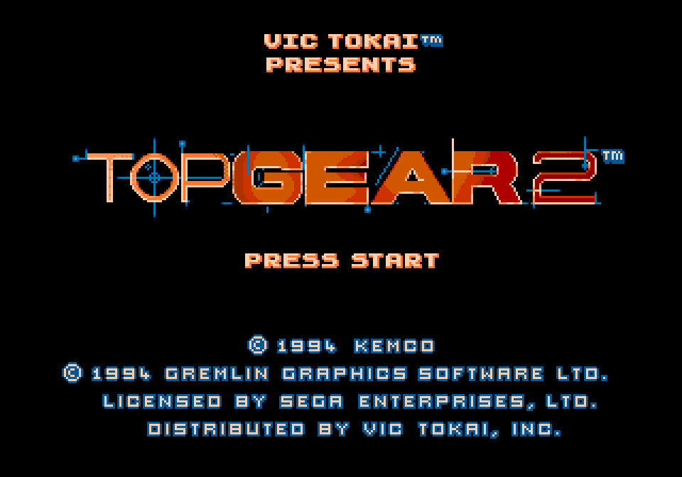
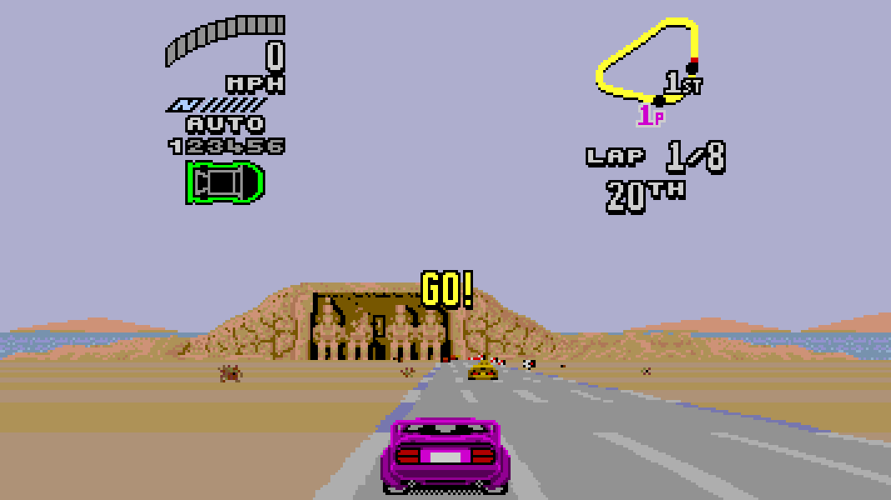
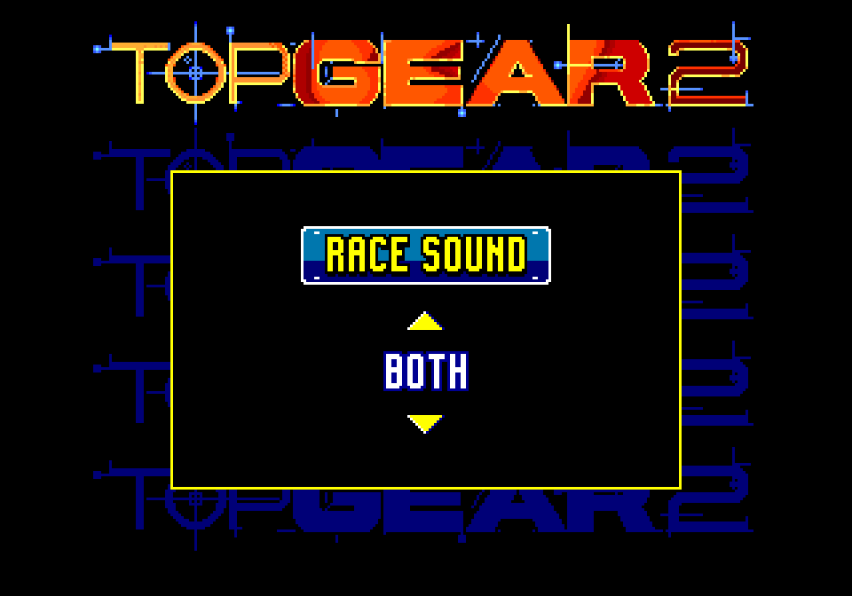
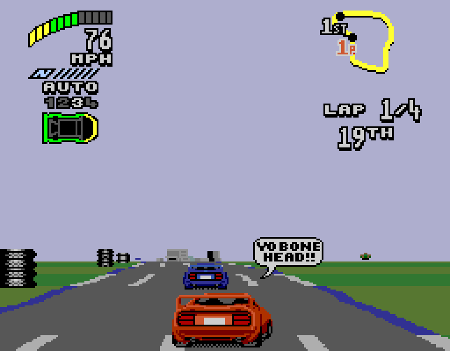
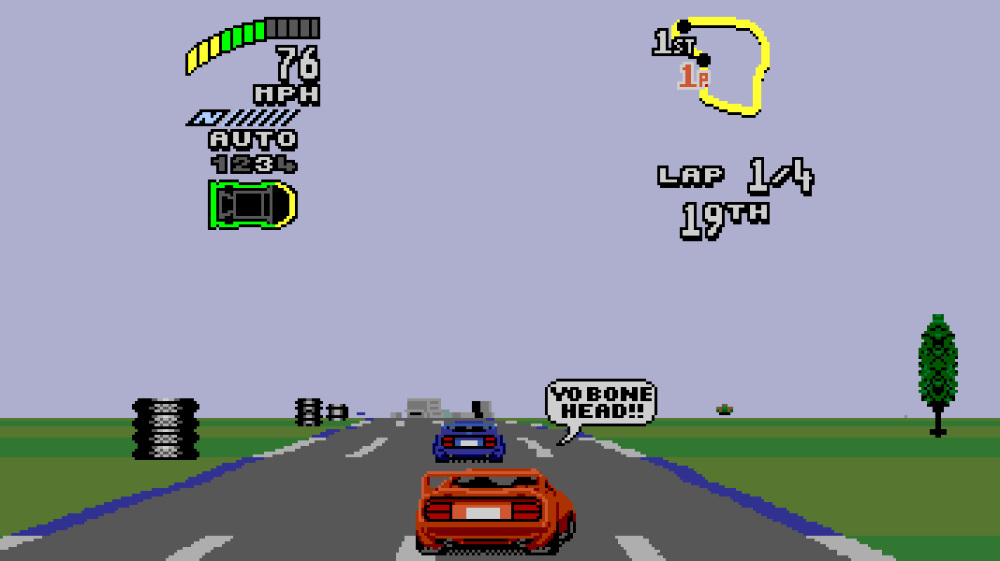
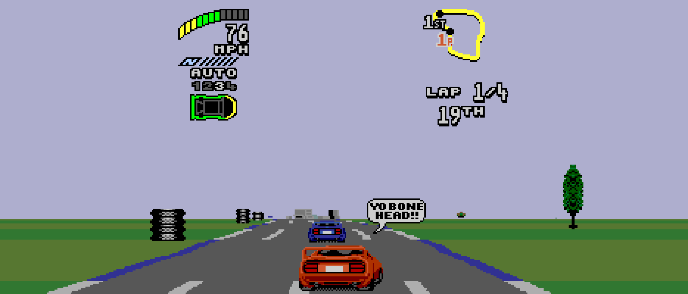
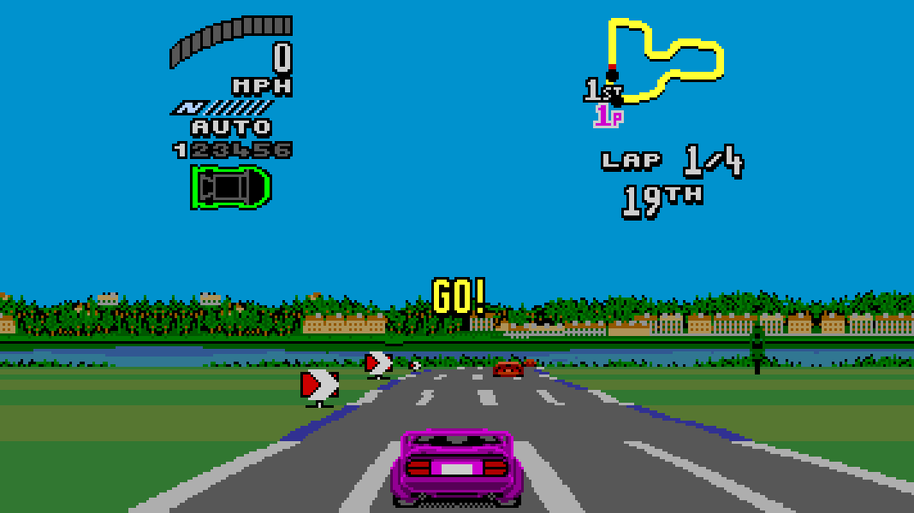
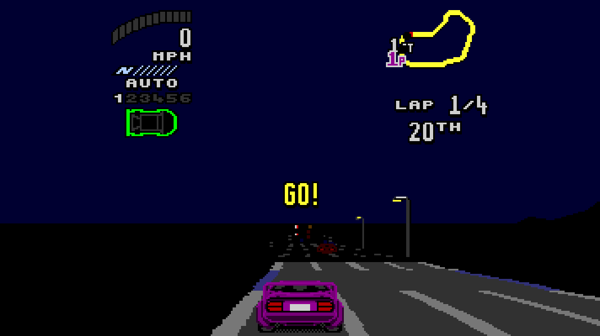
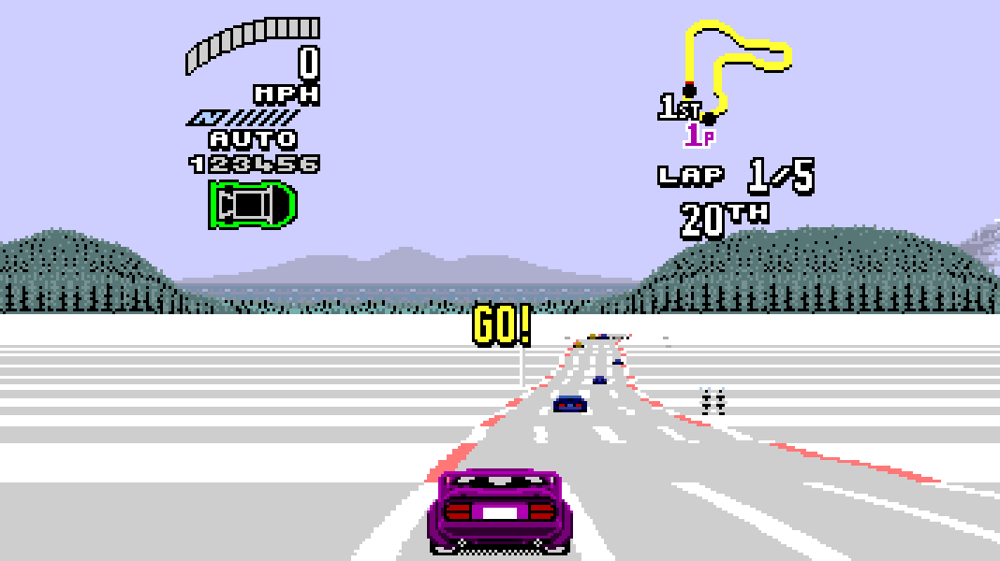

# Top Gear 2 Recomp

A native, widescreen, 60 fps static recompilation of *Top Gear 2* (USA) for
the Sega Genesis / Mega Drive.

The game's 68000 code is translated to C and compiled into a native program.
No emulator core is involved. You supply your own cartridge dump: no ROM is
included, and generated C is not part of the source repository.

<p align="center">
  <a href="docs/images/title.png"></a>
  <a href="docs/images/race-egypt.png"></a>
  <a href="docs/images/sound-both.png"></a>
</p>

## Status and features

Top Gear 2 Recomp plays the whole game, from the title screen through races
in all 16 countries, on Linux (x86_64, including Steam Deck), Windows (x64) and
macOS (Apple Silicon and Intel).

- **Original, Adaptive, 16:9, 21:9 and 32:9 display modes.** The road,
  scenery, opponents and roadside objects extend into the extra width.
  Adaptive fits the width of your window or screen. The HUD can stay centred
  or move to the screen edges.

- **True 60 fps races.** The original draws about 30 new race pictures per
  second. This mode presents 60, while gameplay, physics and lap times stay
  identical to the original. The cost is 50 ms of extra display latency, and
  you can turn it off.

- **Music and sound effects together.** The original makes you choose music
  *or* sound effects during races. A new **BOTH** choice in the game's own
  *Sound → Race Sound* menu plays them together.

- **Hide overscan.** Removes the empty black bands a CRT television never
  showed: eight lines at the top of the race screen (they held only the stray
  boot marks) and sixteen at the bottom, so the race picture fills the
  window. Menus, results and split-screen keep their full picture.

- **Quality of life.** A launcher, an in-game options menu that works with a
  controller alone, save states, rewind and fast-forward.

With every option off, the picture is byte-identical to the original game.

Linux has been played on real hardware. The Windows and macOS builds pass
automated boot tests on CI but still need playtesting on real machines, and
so does the Steam Deck. See [docs/STATUS.md](docs/STATUS.md) for the current
state and open items.

### Widescreen

The same moment of a race in Original (the Genesis's 256-pixel-wide race
frame), 16:9 and 21:9. The wider views reveal the tyre stack on the left and
the tree on the right, which the original frame cuts off. All three have
*Hide overscan* on, so the empty black bands above and below the race are
cropped.

<p align="center">
  <a href="docs/images/aspect-original.png"></a>
  <br>
  <em>Original</em>
</p>

<p align="center">
  <a href="docs/images/aspect-16x9.png"></a>
  <br>
  <em>16:9</em>
</p>

<p align="center">
  <a href="docs/images/aspect-21x9.png"></a>
  <br>
  <em>21:9</em>
</p>

Menus, the shop and the results screens are shown in their original width,
centred. Extending every non-race screen that has scenery is planned.

### Tracks

The game has 64 races in 16 countries, with night, snow, rain and fog.

<p align="center">
  <a href="docs/images/track-france.png"></a>
  <a href="docs/images/track-night.png"></a>
  <a href="docs/images/track-snow.png"></a>
  <br>
  <em>France, Australasia at night, and Canada in the snow.</em>
</p>

## ROM requirements

Use a **Top Gear 2 (USA)** cartridge dump:

| Property | Value |
| --- | --- |
| Size | 1,048,576 bytes |
| CRC32 | `BD3074D2` |
| SHA-256 | `b41909d53090e28c1d1e50941dad01676dd3d19caf26c75f66aac6a3ad689ba6` |

The game finds the ROM by its content, so any file name and extension work.

## Download and install

Releases are published on the
[Releases page](https://github.com/vittau/top-gear-2-genesis-pc/releases).
The first release (0.1.0) is in preparation. Every download is self-contained:
SDL and the C/C++ runtime are linked in, and there is nothing to install,
compile or generate.

| Platform | Download | Requirements |
| --- | --- | --- |
| Linux / Steam Deck | `TG2Recomp-x86_64.AppImage` (one file) or `TG2Recomp-linux-x86_64.tar.gz` | x86_64, glibc 2.35 or newer (SteamOS 3.x, Ubuntu 22.04+), OpenGL |
| Windows | `TG2Recomp-windows-x64.zip` | Windows 10/11 x64 |
| macOS | `TG2Recomp-macos.zip` (universal: Apple Silicon and Intel) | macOS 11 or newer |

Each release also includes a `SHA256SUMS` file.

### Linux

1. Put `TG2Recomp-x86_64.AppImage` and your ROM in the same folder.
2. Make the AppImage executable once (file manager: *Properties →
   Permissions → Is executable*, or `chmod +x TG2Recomp-x86_64.AppImage`).
3. Double-click it, or run `./TG2Recomp-x86_64.AppImage`.

If your system has no FUSE, run it once as
`./TG2Recomp-x86_64.AppImage --appimage-extract-and-run`. The tarball is the
same program as a plain folder: extract it, put the ROM next to `TG2Recomp`
and run it.

### Steam Deck

1. In Desktop Mode, copy the AppImage and your ROM into one folder, for
   example `~/Games/TopGear2`.
2. Right-click the AppImage → *Properties → Permissions → Is executable*.
3. In Steam: *Games → Add a Non-Steam Game → Browse*, select the AppImage,
   then *Add Selected Programs*.
4. Return to Game Mode. The game is in your library and runs with the
   built-in controls alone; no terminal is needed.

### Windows

1. Extract the whole ZIP to a writable folder, such as one under your user
   account. Don't run it from inside the ZIP.
2. Put your ROM in the same folder as `TG2Recomp.exe`.
3. Open `TG2Recomp.exe`.

### macOS

1. Extract `TG2Recomp-macos.zip`.
2. Put your ROM in the same folder as `TG2Recomp.app`, next to the app, not
   inside it.
3. Open `TG2Recomp.app`.

The app is not signed with an Apple Developer ID or notarised. If macOS
blocks it, right-click the app and choose *Open*, then *Open* again, or allow
it under *System Settings → Privacy & Security → Open Anyway*. See
[Apple's instructions](https://support.apple.com/en-us/102445).

### Settings, saves and updating

If no matching ROM is found next to the program, the launcher lets you pick
one.

`settings.ini`, save states and logs are written next to the executable. On
macOS they go next to `TG2Recomp.app`, or to
`~/Library/Application Support/TG2Recomp/` when that folder is read-only (for
example `/Applications`). Keep the folder writable.

Your championship progress is kept by the game's own passwords, as on the
cartridge. To update, quit the game and replace the program files, keeping
`settings.ini` and your save states. Delete `settings.ini` to restore every
option to its default.

## Controls and settings

| Genesis | Keyboard | Gamepad (Xbox layout) |
| --- | --- | --- |
| D-pad | Arrow keys | D-pad |
| A / B / C | Z / X / C | B / A / X |
| X / Y / Z | A / S / D | Y / LB / RB |
| Start | Enter | Start |
| Mode | Backspace | Back |

With the game's default control setup, **B** accelerates, **A** brakes and
**C** fires the nitro. The game's own *Control* menu can change this. Player 2
uses I/J/K/L to steer, N/M/comma for A/B/C and Right Shift for Start, or a
second gamepad.

| Action | Keyboard | Gamepad |
| --- | --- | --- |
| Options menu (pauses the game) | Esc or F1 | Back + RB |
| Fullscreen | F11, Alt+Enter, or Ctrl/Cmd+F | |
| Save state, slots 2–9 | Shift+F2 … Shift+F9 | |
| Load state, slots 2–9 | F2 … F9 | |
| Save-state browser | F7 | |
| Rewind | F8 | Back + R3 |
| Fast-forward (hold) | Tab | |

The options live in the launcher and in the in-game options menu, and are
saved to `settings.ini`:

| Option | Choices | Default |
| --- | --- | --- |
| Widescreen | Off, Adaptive, 16:9, 21:9, 32:9 | Adaptive |
| 60 fps races | On, Off | On |
| HUD | Centered, Edges | Centered |
| Hide overscan | On (crops the empty top/bottom race bands), Off | On |
| Race sound | Sound effects, Music, Both | Sound effects |

Race sound is also in the game's own *Sound* menu. Both menus change the same
setting. A change to 60 fps races takes effect from the next race.

## Build from source

The build generates C from your ROM, so it needs the ROM at build time. The
ROM is read in place: it is never copied into the repository or the output.

Clone the project with its submodules:

```sh
git clone --recursive https://github.com/vittau/top-gear-2-genesis-pc.git
cd top-gear-2-genesis-pc
```

### Linux (x86_64)

Requirements: Git, Python 3, CMake 3.19+, Ninja, a C11/C++17 compiler, and
the SDL2 build dependencies. On Ubuntu or Debian:

```sh
sudo apt-get install --no-install-recommends \
  build-essential cmake ninja-build pkg-config python3 \
  libasound2-dev libpulse-dev libudev-dev \
  libx11-dev libxext-dev libxrandr-dev libxi-dev libxcursor-dev \
  libxss-dev libxxf86vm-dev \
  libwayland-dev libxkbcommon-dev wayland-protocols \
  libgl1-mesa-dev libegl1-mesa-dev libgles2-mesa-dev
```

Then build and run a development build:

```sh
JOBS=4 tools/build-linux.sh /path/to/your/tg2.bin build
build/TG2Recomp /path/to/your/tg2.bin
```

`tools/build-linux.sh` applies the engine patches from
`patches/segagenesisrecomp/`, generates C from the ROM and compiles. `JOBS`
sets the number of parallel compile jobs. The generated C is large, so keep it
low on machines with little RAM. The development build includes a debug server
and diagnostics. Release builds leave them out:

```sh
sdl=$(python3 tools/release/fetch-sdl.py --dest /tmp/tg2-sdl)
tools/release/build-linux.sh --rom /path/to/your/tg2.bin --sdl "$sdl"
```

This downloads and verifies the pinned SDL2 source, links it statically, and
stages the release folder, tarball and AppImage under `build-release/`. Run
it on the oldest glibc you want to support. The official builds use Ubuntu
22.04 (glibc 2.35). On a newer host, set `TG2_SKIP_GLIBC_CHECK=1` to skip
the glibc 2.35 floor check for a local package.

### macOS

Requirements: Xcode Command Line Tools, Python 3, CMake 3.19+ and Ninja
(`brew install cmake ninja`).

```sh
sdl=$(python3 tools/release/fetch-sdl.py --dest /tmp/tg2-sdl)
tools/release/build-macos.sh --rom /path/to/your/tg2.bin --sdl "$sdl"
```

This builds a universal2 `TG2Recomp.app` and its ZIP under `build-release/`.

### Windows (x64, MSVC)

Requirements: Git, Python 3, and Visual Studio 2022 (or its Build Tools)
with the *Desktop development with C++* workload and CMake. From a
*x64 Native Tools* PowerShell:

```powershell
$sdl = python tools/release/fetch-sdl.py --dest "$env:TEMP\tg2-sdl"
.\tools\release\build-windows.ps1 -Rom C:\path\to\tg2.bin -SdlSource $sdl
```

The staged folder, with `TG2Recomp.exe`, is under `build-release\dist\windows\`.

Packaging, CI and the release process are described in
[docs/RELEASING.md](docs/RELEASING.md).

## Documentation

| Doc | Content |
| --- | --- |
| [docs/STATUS.md](docs/STATUS.md) | Current state and open items |
| [docs/BRINGUP.md](docs/BRINGUP.md) | How the recompilation was brought up |
| [docs/WIDESCREEN.md](docs/WIDESCREEN.md) | Widescreen renderer design |
| [docs/FRAMERATE.md](docs/FRAMERATE.md) | 60 fps design and the physics parity proof |
| [docs/AUDIO.md](docs/AUDIO.md) | The sound drivers and the BOTH option |
| [docs/PERFORMANCE.md](docs/PERFORMANCE.md) | Frame timing and audio pacing |
| [docs/VALIDATION.md](docs/VALIDATION.md) | Test ledger: all 16 tracks, long soak runs |
| [docs/RELEASING.md](docs/RELEASING.md) | Builds, packaging and releases |
| [docs/RAM_MAP.md](docs/RAM_MAP.md), [docs/PASSWORDS.md](docs/PASSWORDS.md) | Reverse-engineering notes |

Report bugs with your platform, the build version (in `BUILD-INFO.txt`), your
settings, and the steps to reproduce them. Don't attach ROMs, save states or
generated code.

## Support the project

If you enjoy the port, you can support its development through
[GitHub Sponsors](https://github.com/sponsors/vittau) or
[Buy Me a Coffee](https://buymeacoffee.com/vittau).

## Development disclosure

AI coding assistants wrote most of the code, tools, tests and documentation
in this repository, under the maintainer's direction and review.

## Credits and license

Built on [segagenesisrecomp](https://github.com/mstan/segagenesisrecomp) and
[recomp-ui](https://github.com/mstan/recomp-ui), by Matthew Stanley and
contributors: the recompiler, runtime and launcher this port uses.

Original code in this repository is licensed under the
[PolyForm Noncommercial License 1.0.0](LICENSE.md): free for non-commercial
use.

Required Notice: Copyright 2026 Vitor Machado (https://github.com/vittau)

The submodules keep their own licenses (see `LICENSE.md`). The ROM, the
generated game code and the game's artwork are not covered by the project
license. The screenshots illustrate the project; the artwork shown belongs to
its rights holders. This is an unofficial fan project, not affiliated with or
endorsed by Kemco, Gremlin Graphics, Sega or any other rights holder.
*Top Gear 2* is © 1994 Kemco / Gremlin Graphics Software.
