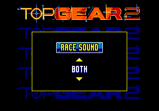
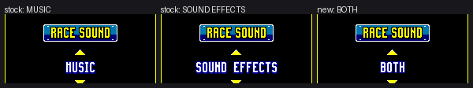
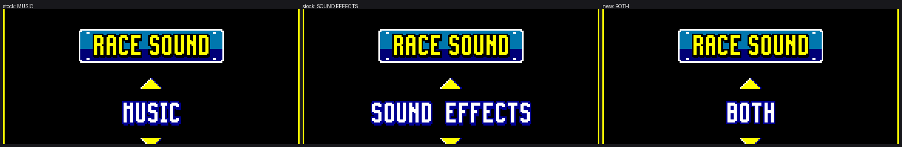
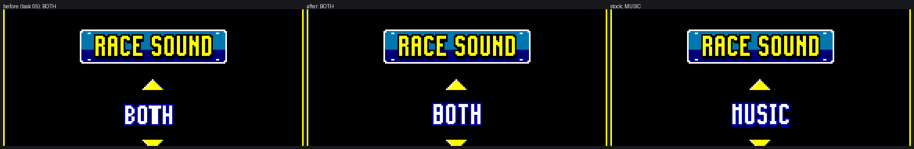

# Music and sound effects at the same time

Top Gear 2 (USA) ships two complete sound systems and one policy word that
selects between them. The port adds a third `RACE SOUND` choice, **BOTH**,
which runs both systems during a race. The stock choices keep their exact
stock behaviour.

All addresses are guest 24-bit addresses. ROM evidence is raw disassembly;
runtime evidence is TCP probes, deterministic `--input-script` runs, WAV
captures, Z80 RAM dumps and the engine's whole-run FM/PSG write dump
(`GENESIS_AUDIO_WRITEDUMP`, which records the writer PC for every write).
Nothing here is copied from another game.

**Status:** implemented and verified headless (stock parity, both command
streams, both audible sources present in the capture). Owner listening
confirmation on real speakers is still required; BOTH is a shared-chip mix,
not a layered mix (see *Limitations*).

## 1. The setting

| Address | Size | Meaning |
|---|---|---|
| `$FF240E` | word | Race sound mode. `0` = SOUND EFFECTS, `1` = MUSIC. A3-relative `-$5FFA(a3)`. |
| `$FF2554` | struct | Menu controller object that owns the SOUND pages. |
| `$FF2560` | word | Current value of the RACE SOUND page (`A4+$0C`). `0` = SOUND EFFECTS, `1` = MUSIC. |

The main menu's `SOUND` item opens a three-row submenu: `RACE SOUND`,
`MUSIC TEST`, `EFFECTS TEST`. `RACE SOUND` opens a value page whose leaf is
`$01F0D4`:

```
01F0D4  andi.w #$FF,d0     ; button mask
01F0D8  bne.s  $01F0DC
01F0DA  rts                ; no button
01F0DC  move.w d0,$14(a4)  ; remember the mask
01F0E0  move.w $0C(a4),d1  ; current value
...
01F0F4  tst.w  d1          ; UP: floor at 0
01F0FC  cmpi.w #1,d1       ; DOWN: ceiling at 1
01F104  addq.w #1,$02(a4)  ; request page redraw
01F108  move.w #2,$18(a4)
01F10E  move.w d1,$0C(a4)  ; commit value
01F116  andi.w #$70,d0     ; A/B/C leave the page
01F11C  move.w #3,$02(a4)
01F122  clr.w  d0
01F124  rts
```

The enter/leave helpers `$01ED3A` / `$01ED60` copy between `A4+$0C` and
`$FF240E`, so the word the race reads is the value shown on the page. The
menu renders text from dynamic 8×16 glyph tiles (two 8×8 VRAM tiles per
glyph) addressed by the sprite attribute table; there is no ROM string for
the value row that can be edited independently of the tile uploader.

Readers of `$FF240E` (raw-ROM scan of `-$5FFA(a3)`):

| Address | Role |
|---|---|
| `$001FBE/$001FC2/$001FF4/$002104` | boot/sound-test save and restore |
| `$01ED3A/$01ED60` | menu enter/leave value copy |
| `$0048E2` | race V-int: tick the 68k SFX engines |
| `$006530` | race init: upload the race SFX driver and start engine sound |
| `$023062` | scene transition: install IRQs when SFX mode |
| `$02503A/$02504A` | sound helper: stop music / reset SFX |
| `$0250E2/$02511C` | SFX command gates |
| `$0251F4/$02522E` | music start/refresh |
| `$025298` | SFX reset gate |
| `$0252CC` | per-frame engine-SFX gate |

## 2. The drivers

### Music: 8 KB Z80 driver ("Genesis Music / FX by Sound Images v1.4")

* Image: ROM `$02589A..$027899`, copied to `$A00000..` by `$024C76`
  (called once from reset at `$002090`).
* Reset vector: `DI; LD SP,$1FF0; JP $0042`; the ASCII banner sits inside
  the image.
* Mailbox: `$A00080` = command, `$A00081` = status, `$A00084` = pause/stop
  flag, `$A00087..$A0008A` = little-endian work pointer (initialised to
  `$0F0000`), `$A00091..$A00093` = volume/pan.
* 68k veneers: `$024CD4` (send command), `$024D22` (read status),
  `$024D04` (command `$FF` = stop music), `$024D50/$024D64`
  (`$A00084` = 1/0).
* The race track is chosen by `$0251F4` (also reached from `$025090`
  inside the engine-sound update): it reads the current attract/track index
  at `$FF16BE`, masks to 2 bits, and sends track `{1,2,3,6}` from the table
  at `$02522A`.

### Race SFX: 68k FM/PSG engine plus a small Z80 image

* FM engine: `$070A12` starts a channel, `$070AC0` updates six FM channels,
  `$070B48` services a channel's stream, `$0708E0` resets PSG state.
  State bases are `$FF862E` (FM) and `$FF8622` (PSG).
* PSG engine: `$07090E` starts a PSG effect, `$07092C` updates four PSG
  channels, `$0709FC` clears state.
* Per-frame ticks: `$070010` (PSG) and `$07001C` (FM), called from the race
  V-int at `$0048F2/$0048FE`.
* Small Z80 image: ROM `$0701F6..$0708DF` (0x6EA bytes), copied to
  `$A00000` by `$0700C8`, with command bytes at `$A0025E..$A00261`
  written by `$07018A`.
* The image initialises `$A00194` from the table at `$070FF0` and
  `$A00004`/`$A000CC` from `$070FA8`. Its reset path only reacts to
  `$A0025E`.
* **The command writer `$07018A` has no caller** (checked in the generated
  dispatch: the address is only a table entry, never a `RECOMP_CALL_NATIVE`
  target), and a whole-race write log shows no writes to `$A0025E..$A00261`
  after upload. This image is vestigial in the race; its only real effect is
  that it overwrites the first 0x6EA bytes of the 8 KB music driver in Z80
  RAM.

### Race init

`$006530`:

```
move.w -$5FFA(a3),d0       ; $FF240E
or.w   -$6BCE(a3),d0       ; attract/demo flag
bne    keep_music
jsr    $0253EE             ; upload the race SFX Z80 image, reset SFX state
jsr    $025418             ; start the engine-sound FM effect
keep_music:
```

`$0253EE` is exactly: upload image (`$070000` -> `$0700C8`), PSG reset
(`$070008`), FM state clear (`$070014`).

## 3. Root cause of the exclusivity

It is **policy plus shared hardware**, not a channel-count allocator:

1. One `$FF240E` word drives every sound decision. In MUSIC mode the game
   skips the SFX image upload, never starts engine sound, and the race
   V-int never ticks the 68k FM/PSG engines. In SFX mode it skips the music
   start (and stops the driver with command `$FF`).
2. Both engines program the *same* YM2612 and SN76489. There is no channel
   allocator between them: the 68k engine keys and voices all six FM
   channels and the PSG directly, exactly as if music were not running.
3. The 68k engine must request the Z80 bus (`$A11100`) to reach the chip
   registers. Every SFX update stalls the Z80 music driver while the 68k
   owns the bus.
4. The race SFX Z80 image is uploaded into `$A00000`, overwriting the music
   driver. Only one of the two can occupy Z80 RAM.

So the cartridge *can* be made to run both code paths, but they share one
chip and one bus. That is the real limit the owner suspected, and it is why
the simplest implementation is a shared-chip mix rather than a clean
layered mix.

## 4. What stock modes do

| Mode | Music driver A | SFX driver image B | 68k FM/PSG engine |
|---|---|---|---|
| MUSIC | runs, race track started | not uploaded | never ticked |
| SOUND EFFECTS | stopped (`$A00080=$FF`), still resident | uploaded (idle) | ticked, all channels |

SFX commands are not "sent and dropped" at the driver. They are never sent:
the wrappers return early on `tst.w -$5FFA(a3)`.

Measured with `GENESIS_AUDIO_WRITEDUMP` over race frames 3000–5600 (writer
PC from the engine, `pcz=$FFFF` means the 68k):

| Mode | Z80-origin writes | 68k-origin writes | Z80 writer PCs |
|---|---:|---:|---:|
| MUSIC | 333,691 | **0** | 8 (`$0CB2`, `$0C4C`, `$0C4F`, …) |
| SOUND EFFECTS | 244,797 | 17,912 | 12 (`$067F`, `$068E`, `$0494`, …) |
| **BOTH** | **332,691** | **17,804** | **8** (`$0CB2`, `$0C4C`, `$0C4F`, …) |

BOTH reproduces 99.7 % of the MUSIC Z80 write stream and 99.4 % of the SFX
68k write stream, in the same run, from the *same* chip. At race frame 4300
the Z80 reset vector also proves which image is resident:

| Mode | `$A00000..` |
|---|---|
| MUSIC | `F3 31 F0 1F C3 42` (music driver `DI; LD SP,$1FF0; JP $0042`) |
| SOUND EFFECTS | `C3 10 04` (SFX image `JP $0410`) |
| BOTH | `F3 31 F0 1F C3 42` (music driver kept resident) |

## 5. Chosen technique: a session-owned three-state choice

The port adds a third SOUND menu state, `BOTH`, and makes the player's choice
**host state** (`game/tg2_audio_both.c`, `s_mode`), not a value it hopes the
cartridge word still holds:

| Host mode | Page value | `$FF240E` presented to SFX-side reads | to music-side reads |
|---|---:|---:|---:|
| `SOUND EFFECTS` (stock) | 0 | stock (0) | stock (0) |
| `MUSIC` (stock) | 1 | stock (1) | stock (1) |
| `BOTH` | 1 | 0 | 1 |

`$FF240E` never leaves `{0,1}`; BOTH exists only in host state and is
presented to guest reads at the instruction that consumes them.  A present
saves the cartridge's own word on a small stack and the following restore puts
it back, so the value is only different for the instruction that reads it.  The
stack makes the sites re-entrant: an SFX-side read nested inside a music-side
read restores exactly.

### Race policy hook sites

All sites were audited against raw ROM disassembly and are generated block
labels, so the hook fires at that instruction.  `present 0` / `present 1`
rewrite the word just before the `move.w`/`tst.w`; the restore site runs after
the flags are set and before the dependent branch (restoring the RAM word does
not change flags).

Every reader of `$FF240E` in the generated code is covered:

| Present site | Stock instruction | Side | Restore site | Effect |
|---|---|---|---|---|
| `$006530` | `move.w -$5FFA(a3),d0` | SFX | `$006538` (`bne.s`) | race init uploads SFX state and starts engine sound |
| `$0048E2` | `move.w -$5FFA(a3),d0` | SFX | `$0048EA` (`bne.s`) | race V-int ticks `$070010` / `$07001C` |
| `$0250E2` | `tst.w -$5FFA(a3)` | SFX | `$0250E6` (`beq.s`) | SFX command gate opens |
| `$02511C` | `tst.w -$5FFA(a3)` | SFX | `$025120` (`beq.s`) | second SFX command gate opens |
| `$02503A` | `tst.w -$5FFA(a3)` | SFX | `$02503E` | helper skips the music stop, resets SFX |
| `$02504A` | `tst.w -$5FFA(a3)` | SFX | `$02504E` (`bne.s`) | SFX reset gate opens |
| `$02529A` | `tst.w -$5FFA(a3)` | SFX | `$02529E` (`bne.s`) | SFX reset gate opens |
| `$0252CC` | `tst.w -$5FFA(a3)` | SFX | `$0252D0` (`bne.s`) | per-frame engine-SFX update runs |
| `$025088` | `tst.w -$5FFA(a3)` | music | `$02508C` | music start/refresh gate stays open |
| `$025200` | `tst.w -$5FFA(a3)` | music | `$025204` (`beq.s`) | race music track start is not skipped |
| `$02523A` | `tst.w -$5FFA(a3)` | music | `$02523E` (`beq.s`) | music command 6 is not skipped |

`$023062` (scene transition IRQ install) is deliberately **not** hooked: it
selects the boot IRQ pair versus the scene pair, and the stock MUSIC path is
the one the race scenes are qualified with.  `$001FBE/$001FF4` (boot sound
test) save and force the word on their own stack and are left alone.

`$0700C8` (entry of the race SFX Z80 image upload) is hooked as a whole
function: the hook returns 1 at its first instruction, so the upload is
skipped while BOTH is live and the music driver survives.  `$01F0D4` (the RACE
SOUND leaf) is replaced by a host handler.

### Menu value page

`$01F0D4` is replaced by `menu_value_handler()`:

* It owns the three-state choice: DOWN walks SOUND EFFECTS → MUSIC → BOTH, UP
  walks back; the page value written to `A4+$0C` stays in `{0,1}` (BOTH uses
  the MUSIC value) so the page state machine, the sprite builder and the menu
  teardown that stores `$0C(a4)` into `$FF240E` all keep working unchanged.
* If BOTH is active and the page still holds 0 (a fresh boot whose cartridge
  word is the boot value, or a guest reset), it forces the page value to 1 and
  requests one redraw, so the page can never display a value that contradicts
  the mode in effect.
* It leaves `D0=0` and the stock flags (`Z=1`, `N=V=C=0`, `X` preserved) on
  every exit path, matching the stock leaf's `clr.w d0` return.

### Persistence

The choice is a player option, `[mods.racesound] mode = sfx|music|both`
(default `sfx`, the cartridge's own boot value), saved with the other options
in `settings.ini` and editable from the launcher Mods page and the in-game
overlay.  `TG2_RACE_SOUND=sfx|music|both` overrides it for automated captures.
The in-game page updates the option in memory, so the next save writes it.

Guest reset and state load (`tg2_audio_reset`) clear the pending patch and the
tile cache but **keep** the player's choice: the choice is the player's, the
cartridge word is the cartridge's.

### Why not a second virtual chip

A second YM2612+SN76489 would give a clean layered mix, but it needs an
engine change to tag every chip write by origin, instantiate a second copy of
both chip models, render/mix it, and keep save-state/rollback state for it.
It also does not by itself stop the 68k engine from stalling the Z80 bus.  The
shared-chip character is documented under *Limitations*.

## 6. Why the first implementation did not engage in real play

The first version (task 05) required the cartridge word to still read MUSIC:

```c
static int both_active(void) { return s_both && ram_read16(0xFF240E) == 1; }
```

That is the wrong source of truth, because `$FF240E` is **not** the menu value.
It is written in exactly four places in the whole ROM:

| Address | Writer |
|---|---|
| `$002104` | boot: store 0 (SOUND EFFECTS default) |
| `$001FC2` / `$001FF4` | boot sound test: force 1, then restore the pushed value |
| `$01ED60` | **menu scene teardown only** (`$01EC84`/`$01ECC2` → `$01ED46`) |

`$01ED3A` loads it into the controller at menu scene entry; the value page
only keeps it in `A4+$0C`.  Live probe on the RACE SOUND page (TCP, one frame
apart while the player cycles and leaves the page):

| Point | `$FF240E` | page `$FF2554` | page value `$FF2560` |
|---|---:|---:|---:|
| RACE SOUND page open | 0 | 4 | 0 |
| DOWN → MUSIC | 0 | 4 | 1 |
| DOWN → BOTH | 0 | 4 | 1 |
| leave page | 0 | 2 | 1 |
| back on the main menu | **0** | 0 | 1 |
| menu teardown → game setup | **1** | 180 | 0 |

So while the page is open the host flag is set but the cartridge word is still
0.  Every path that reaches a race without the menu scene teardown — a guest
reset, a state load, or any future route that starts a race from another scene
— left the word at 0, `both_active()` false, and the eight hooked SFX-side
sites alone meant **stock SOUND EFFECTS**: the music driver stopped and only
the 68k SFX engine ran.  The same hole existed on the music side, unseen: the
old build left the three music-side reads unhooked, so with the word at 0 the
music gate `$025088` skipped the race track entirely and even a BOTH selection
that did engage could lose its music.

Two more real-play defects followed from the same mistake:

* The page value was reloaded from the cartridge word at menu entry, so any
  visit to the page before the teardown showed the stale 0 while the host
  still painted "BOTH" — the text and the setting disagreed.
* Nothing persisted: after a restart the player had to find the page again.

What was **not** wrong, and what the owner's report cannot be pinned on: on
the plain menu route the engines really do both run.  The write dump of a
BOTH race contains 12,600 68k-origin chip writes and 226,910 Z80-origin
writes; MUSIC contains 0 68k writes and SOUND EFFECTS 12,614, and the three
offline WAV captures of the same route are byte-identical before and after
this change (see *Evidence*).  The remaining reason BOTH can still feel like
"only music" by ear is the shared-chip mix (the music driver writes the same
six FM channels about twenty times as often as the SFX engine, so SFX notes
are short and often re-keyed) plus the real-device dropouts of task 15; both
are outside the menu/audio-policy surface this task owns.

## 7. The "BOTH" text

### Where the menu font lives

The value row is **sprites**, not the name table: sprite attribute entries at
`y=$0104`, palette 3, 8x16 glyphs over two 8x8 VRAM tiles, tile numbers
allocated per draw (MUSIC: tiles 479..488; SOUND EFFECTS: 455..478).  The
tile pixel encoding is exact:

* one 8x16 cell per character on an 8-pixel column grid,
* 2-pixel strokes, one outline pixel in palette entry **1**,
* the stroke body uses entry **3** on rows 0..7 and entry **2** on rows 8..15.

Searching the raw ROM for the glyph bitmaps found nothing in any plausible
encoding (4bpp 8x8 and 8x16 tiles, 1bpp 8x16 row-major and column-major, 2bpp
pair-planes, bit-reversed variants, all 24 colour permutations, and the text
itself as glyph-code strings).  The menu font is part of the packed graphics
archive the game unpacks at run time, so there is no raw table to index.

### How the glyphs are made

`game/tg2_audio_both.c` therefore reproduces the font's own construction:

| Letter | Source |
|---|---|
| `O` | the menu font's own O, transcribed from the value page's SOUND EFFECTS row (tile 457) |
| `T` | the menu font's own T, same row (tile 475) |
| `B` | that font's `D` bowl (tile 463) plus the `E` middle bar (tile 465) |
| `H` | that font's two stems (any stem letter) plus the `M` crossbar (tile 479) |

The 16 bytes per letter are the stroke shape; the tile generator adds the
outline, the 3/2 body split and writes the two VRAM tiles.  Regenerating the
font's own O with this generator reproduces tile 457 except for six pixels in
the bottom outline row, i.e. the shapes are the game's, not an approximation
of them.

Placement matches how the game centres its own values: the four letters are
painted as one continuous 16-row band and centred on `x = 160`, which lands
them at 144..175 against MUSIC's 141..178 and SOUND EFFECTS' 108..211 (all
three centre on 159.5).  The sprite entries are **not** moved: the game re-DMAs
its shadow attribute table every frame from RAM, so a sprite move does not
stick; painting across the row's own columns is stable and keeps the palette,
priority and vertical alignment the game chose.

The stock row is cached the first frame BOTH is painted and written back when
BOTH is left (BOTH and MUSIC share the page value, so the game does not redraw
that row by itself), and the cache is re-captured whenever the game rebuilds
the row.



## 8. Evidence

Every capture below is controller input only (`tools/tg2_both_route.py`,
`tools/tg2_menu_capture.py`, `tools/tg2_audio_compare.py`); nothing writes
guest memory.  The write dump is the engine's `GENESIS_AUDIO_WRITEDUMP`
(`pcz=$FFFF` is a 68k-origin chip write), windowed to the last 1800 sound
frames of each run, which is the race.

### Engagement on every route

`build/` is the trace-enabled build (TCP route driver, 4:3); `build-rel/` is
the release-config build the owner plays (`GEN_ENABLE_TRACE=OFF`,
`--widescreen 16:9`, `TG2_RACE_60FPS=1`, driven by the same route as a runner
input script).  The write dump is windowed to the race.

| Build | Route | Menu value | `$FF240E` in the race | 68k chip writes | Z80 chip writes | Both engines |
|---|---|---|---:|---:|---:|---|
| rel | menu → SOUND → RACE SOUND → BOTH → leave (B) → 1P race | BOTH | 1 | 12,600 | 226,910 | yes |
| rel | same, MUSIC | MUSIC | 1 | 0 | 236,711 | music only (stock) |
| rel | same, SOUND EFFECTS | SFX | 0 | 12,614 | 117,708 | SFX only (stock) |
| rel | **direct** (never opens the SOUND pages; BOTH persisted) | BOTH | **0** | **12,600** | **226,910** | **yes** |
| dev | menu route, leave with **A** instead of B, BOTH | BOTH | 1 | 16,800 | 302,187 | yes |
| dev | password / CONTINUE route, BOTH | BOTH | 1 | 6,300 | 119,669 | yes |
| dev | second race after finishing the first, BOTH | BOTH | 1 | 12,614 | 234,130 | yes |

The dev counts are larger because that capture holds the throttle for 40 s of
wall frame samples after the race starts, while the release scripts stop at a
fixed frame; the ratio between the two builds is not the point, the presence of
68k-origin writes on every BOTH row is.

The password row is `build/final/route-password`: WAV peak 9166 / RMS 1643.89
over 18.6 s of race after the prefilled password is submitted from the ENTER
PASSWORD screen (`--race-frames 900`).  The second-race row
is race 2 of `build/both/race2-both`, whose two WAVs (`race1.wav` peak 9491,
`race2.wav` peak 11396) and write dump both show the mode surviving the
finish/results/next-race flow.

The **direct** row is the fix: with `TG2_RACE_SOUND=both` the host mode is BOTH
from boot, the player walks straight to START, the cartridge word is never
written and still reads 0 at the race, and both engines run anyway.  The
previous implementation required that word to be 1 and played stock SOUND
EFFECTS on this path.

Per-mode WAVs on the identical dev route (`--mode music|sfx|both`, 4:3) and on
the release route (16:9 + 60 fps) are listed under *Three-mode captures*.

### Stock modes are sample-identical

Same deterministic scripts, same build settings, before (task 05 code) and
after this change.  Whole-run WAV capture, SHA-256:

| Capture | before | after |
|---|---|---|
| MUSIC | `b59ac03333e3e1b2bb03d65e5c18badd…` | `b59ac03333e3e1b2bb03d65e5c18badd…` |
| SOUND EFFECTS | `0ad86a4ad6ba9be18d86e455beaf7d03…` | `0ad86a4ad6ba9be18d86e455beaf7d03…` |
| BOTH | `6d213a069a58a951449fae2ab2eaf250…` | `6d213a069a58a951449fae2ab2eaf250…` |

The 4:3 cold-boot fingerprints also still match the documented stock values:
frame 60 `2A0B972960C5E325`, frame 300 `1131D937D70234FD`.

The miss/floor manifests (`dispatch_misses.toml`, `floor_coverage.toml`,
`interior_label_misses.toml`, `floor_unsafe.toml`) contain zero entries after
every run.

### Three-mode captures on the same route

`build/final/route-{music,sfx,both}/race.wav`, 223,721 Hz stereo, the same
deterministic route, WAV started when the race clock starts and stopped 2400
frames later.  `_both-169` is the same BOTH run with 16:9 + 60 fps on.

| Capture | Peak | RMS | 68k writes in the race |
|---|---:|---:|---:|
| `route-music` | 7855 | 1369.85 | 0 |
| `route-sfx` | 6060 | 1471.19 | 16,814 |
| `route-both` | **10017** | **1602.62** | 16,800 |
| `route-both-169` (16:9 + 60 fps) | 9529 | 1601.93 | 16,800 |

The release-config 16:9 + 60 fps runs of the same route are whole-run WAVs
(`build/final-rel-{music,sfx,both}`, 107 s each); they are the files in the
sample-identity table below.

BOTH is the loudest of the three and carries the SFX band energy on top of the
music.  Per-band 20 ms envelope RMS (`tools/tg2_audio_compare.py`):

| Band | MUSIC | SOUND EFFECTS | BOTH |
|---|---:|---:|---:|
| 50–200 Hz | 450.5 | 444.9 | **467.4** |
| 200–500 Hz | 323.7 | 299.7 | **364.4** |
| 500–1000 Hz | 114.0 | **297.7** | 166.1 |
| 1000–2000 Hz | 105.3 | 120.9 | **160.7** |
| 2000–4000 Hz | 69.7 | 35.6 | **107.4** |

BOTH is above both single modes in four of the five bands and between them in
500–1000 Hz, which is what a mix of the two sources looks like (the music
dominates that band and BOTH keeps its level plus part of the SFX).  In the
10 % of race windows where MUSIC is quietest, BOTH is **6.38×** its RMS
(73 → 465) because the SFX engine is still playing, and BOTH matches the SFX
capture there (465 vs 466): the extra energy is the engine, not music.  A
sample-level music correlation is not meaningful here because the two runs
start the track a few frames apart and the 68k engine steals notes from it.

### The menu page





Three pages from one run of the same build: stock MUSIC (141..178), stock
SOUND EFFECTS (108..211) and the new BOTH (144..175); all three centre on
159.5 and share palette entry 1 for the outline and entries 3/2 for the body.



Left: the task 05 host-drawn glyphs (white body, dark outline, left aligned on
the MUSIC column grid).  Middle: the new font-derived glyphs.  Right: the
game's own MUSIC row.

## 9. Reproduction

```sh
JOBS=8 tools/build-linux.sh ~/roms/genesis/tg2.bin build

# Interactive route capture on a trace-enabled build (TCP, port 4550):
python3 tools/tg2_both_route.py --mode both --out build/final/route-both
python3 tools/tg2_both_route.py --mode both --widescreen 16:9 --60fps \
    --out build/final/route-both-169
python3 tools/tg2_both_route.py --mode both --route password --out build/final/route-password
python3 tools/tg2_both_route.py --mode both --exit A --out build/final/route-exit-a

# Menu page captures (stock values plus BOTH, 1x and 3x):
python3 tools/tg2_menu_capture.py --sheet

# Deterministic release-config runs (no command server):
python3 tools/tg2_both_route.py --mode both --script-out build/rel-route-both/route.input --script-race
GENESIS_AUDIO_WRITEDUMP=build/rel-route-both/writes.txt \
SDL_AUDIODRIVER=dummy TG2_RACE_60FPS=1 build-rel/TG2Recomp ~/roms/genesis/tg2.bin \
    --no-launcher --widescreen 16:9 --wav build/rel-route-both/race.wav \
    --input-script build/rel-route-both/route.input --hash-frames 60

# Audibility numbers:
python3 tools/tg2_audio_compare.py --music .../route-music/race.wav \
    --sfx .../route-sfx/race.wav --both .../route-both/race.wav
```

`TG2_RACE_SOUND=sfx|music|both` forces the choice without touching
`settings.ini`; `TG2_RACE_60FPS` and `--widescreen` behave as before.

## 10. Limitations

* BOTH is a **shared-chip mix**, not a layered mix.  The 68k SFX engine
  programs the same six FM channels and the same PSG, and it owns the Z80 bus
  while updating them; the music driver writes those registers about twenty
  times as often, so SFX notes are short and can be re-keyed mid-note.  Music
  notes can be stolen or delayed (measured: the BOTH music write stream is
  0.3 % smaller than MUSIC's, the SFX write stream 0.6 % smaller than SFX's).
  Real-device glitches are task 15's subject and are not addressed here.
* The `BOTH` glyphs are drawn by the port from the menu font's own geometry,
  not from a ROM string (the font is packed; see section 7).  B and H are
  composed from the font's own parts because the game never renders those
  letters on this page.
* The option is honoured from the next race start; the in-game page applies it
  immediately.
* A second virtual YM2612+PSG (clean layered mix) remains the next step if the
  shared-chip mix is not acceptable by ear.
