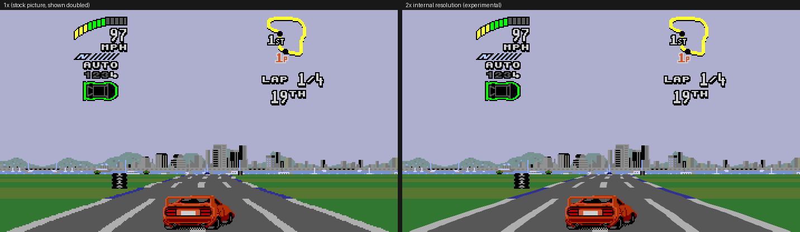
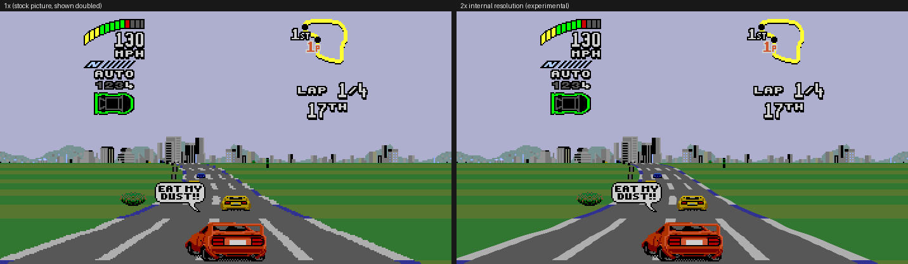
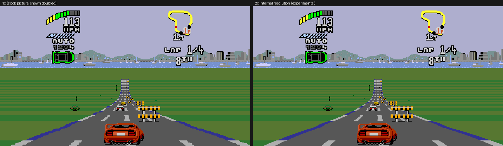
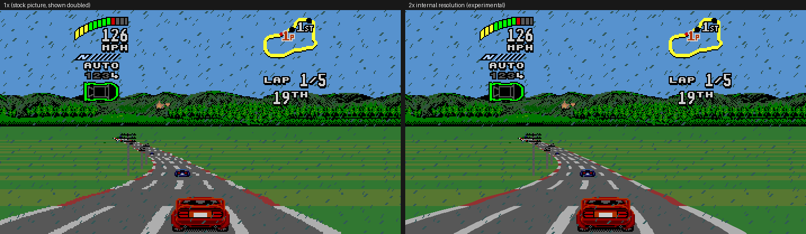
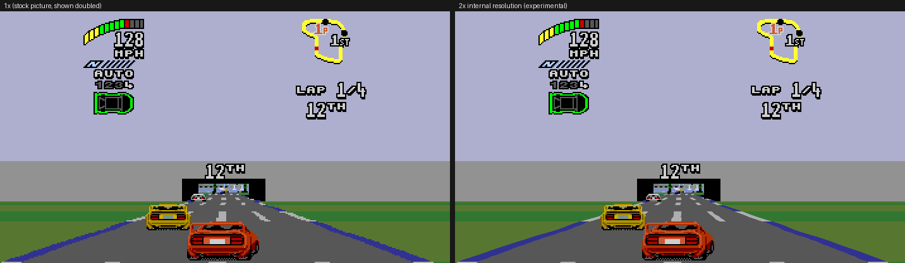
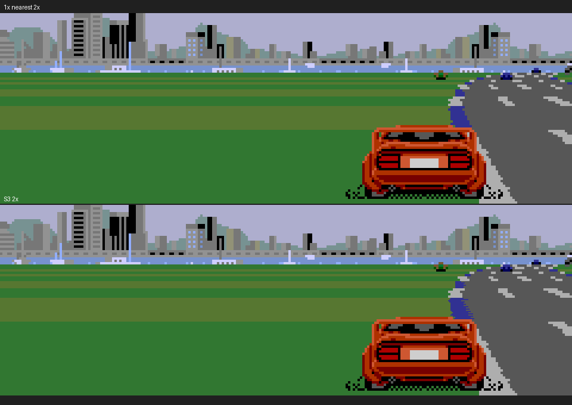

# High-resolution rendering: ground truth, architecture and plan

**Implementation status:** S1/S2 were implemented and verified by task 31
(§12); S3 implementation and local technical qualification are complete as
task 33 (§13), with owner visual approval on 2026-11-10. S4–S7 remain planned,
apart from the minimum experimental scale control already included in S3.
Detailed sprites/HUD/plane-A work, full N× + 60 fps qualification, live scale
switching and future NTSC exclusion retain the limitations listed in §13.5.

**Task 29 — research and design.** The original stock-ROM findings and design
follow below; current implementation results, costs, comparisons and the
reduced validation plan are recorded in §13.

The original research was measured or read on the stock USA ROM
(CRC32 `BD3074D2`). Evidence paths are private under `build/highres/`, as the
repo rules require. Unless stated otherwise the presentation shows a
single-player race, widescreen Off, 60 fps Off, Hide overscan Off, so the frame
is the full 224-line picture.

Status of this document:

| | |
|---|---|
| Verified by ROM disassembly | road/raster emitters, LOD block and table, mapper entry, per-line state producer |
| Verified by runtime capture | per-line scroll/atlas state over 12 race frames; 18k mapper entries with model indices and pattern sets; atlas geometry and palette banks decoded from a live VRAM dump |
| Measured locally | S3 CPU cost at 2×/3×/4× on this Mac, with scope and results in §13.2 |
| Estimated | Ryzen 3500U / Steam Deck cost extrapolations; device and release performance remain unverified |
| Not derived | the per-object-type LOD ladder (which model is most detailed, and the exact screen thresholds), `$FF1894` bias semantics on other tracks |

---

## 0. Scope, rules and what "N×" means

The owner's requirement (`docs/ROADMAP.md`, "High-resolution rendering"):

- redraw the road from the game's own per-line parameters at N× resolution,
  not by upscaling the 224-line raster;
- always draw the most detailed sprite variant, scaled to the on-screen size
  with good filtering and sub-pixel positions;
- scale the background layers cleanly and keep the HUD sharp;
- use the game's own assets, made better.

"Render scale" here means the **presented picture** is `N × 356 × 200`
(16:9, Hide overscan on) for N = 2, 3, 4, instead of `356 × 200`. The guest
VDP, the raster program, the simulation and the font/tile data stay native.
The only thing that changes is what our renderer writes into the presented
frame and how tall that frame is.

Rules inherited from `AGENTS.md` and `ROADMAP.md`:

1. With the option Off (and with every other option Off) the presented output
   must stay byte-identical: frame 60 `2A0B972960C5E325`, frame 300
   `1131D937D70234FD`. At this task's starting commit these hashes reproduce
   on the current build (including with the spike hooks; see §10).
2. It is an option; `settings.ini` + launcher Mods page + in-game overlay, like
   `[mods.race60]`, `[mods.widescreen]`, `[mods.hud]`, `[mods.overscan]`.
3. Presentation only: no guest RAM/VRAM/CRAM/CPU writes, no new simulation
   parameters, no change to object activation, collision or SAT construction.
4. NTSC (task 28) runs at native source resolution and is mutually exclusive
   with a render scale above 1×. Scanlines run at **output** resolution and
   must work on an N× frame. Task 28 is paused, so this design only defines
   the slots; see §5.1.

---

## 1. What a race picture is made of

### 1.1 The raster program

`$004654..$00466A` copies a self-modifying H-interrupt program from ROM
`$004682..$004703` to `$FFF9FE`. Its records are streamed through A5:

| List pointer | Meaning | Source |
|---|---|---|
| `$FF231E` | primary raster list | A3-`$60EA` at `$004898` / `$0049D6` |
| `$FF01E6`, `$FF2324`, `$FF232C` | alternate list / offset / base | `$0048D8`, `$0048D4` |

Each record writes VDP data/control longs. The two forms that matter to a race
row are (see §10 for the disassembly):

- `$46C6..$46D0`: `move.w (a5)+,(a6)` / `move.l #$40000010,4(a6)` /
  `move.w (a5)+,(a6)` — a **VSRAM write with two words** (VSRAM[0] = plane A
  vertical scroll, VSRAM[1] = plane B vertical scroll), and
- the `$2C9D` / `$601E` / `$6042` entry forms, which are the first opcodes the
  widescreen qualifier accepts at `$FFF9FE`.

H-scroll is written the same way, through the VRAM H-scroll table at `$B800`
(`reg[13]=$2E`), one word pair per line.

Therefore the game's per-line state *is* the raster list, and by the time a row
is rendered the state is already visible in `GVDP`: `reg[]`, `vsram[0..1]`,
`vram` (H-scroll table, tiles, name tables) and `cram`.

### 1.2 The road emitters

`$007A10` is the road state builder. It reads the race descriptor at
`$FF241C` (`-$5FEC(a3)`), tests **bit 3** and **bit 4** of descriptor byte 3
(`$7A86`, `$7A90`) and picks one of three emitters, each with its own per-row
jump table:

| Descriptor flags | Path | Per-row jump table |
|---|---|---|
| bit 3 set | `$7C68` … | `$7CE4` |
| bit 4 set | `$7DFC` … | `$7E78` |
| neither | `$7A9A` … | `$7B08` |

The row emitters (`$7B88`, `$7BA4`, `$7BC4`, `$7BEC`, `$7C14`, `$7C3E` and the
`$7CDC`/`$7E70` variants) write the raster list records and the VSRAM pairs.
Their inputs, all read from RAM:

| RAM | A3 offset | Role (evidence) |
|---|---|---|
| `$FF17BC` | `-$6C4C` | horizon / screen limit; measured **200** during a race |
| `$FF1DBE` | `-$664A` | road row/height offset added to the first raster line |
| `$FF1D9E` | `-$666A` | race clock/scroll value copied into D5 (stripe/scroll phase) |
| `$FF0C5E` | `-$77AA` | per-line road table base (**not** the atlas) |
| `$FF231A` | `-$60EE` | picture staging pointer, `+$370` = VSRAM table |
| `$FF2F4A` | `-$54BE` | per-row "row kind" byte table |
| `$FF8EBC` | absolute | phase → sub-emitter index table (jump table selector) |
| `$FF1D30`, `$FF1D3C` | `-$66D8`, `-$66CC` | row-count/segment inputs |
| `$FF1996` | `-$666A` | sampled segment-table base (RAM_MAP) |

The player snapshot the picture build copies immediately before this
(`$00681E..$006846`) carries the camera: `+$7C` view position, `+$80` state,
`+$84` slope, `+$86` curvature. The physics copy is `+$14`/`+$16`.

### 1.3 Measured per-line state

`tools/highres_probe.py` (new, committed) captures `tg2_video {"rows":1}` plus
the player record, a full 64 KiB VRAM dump and CRAM at chosen race frames.
Evidence: `build/highres/road-c00/samples.json` (12 samples, Auckland).

Per presented picture over native lines 8..207 (200 rows):

| Measurement | Range over 6 samples |
|---|---|
| Distinct 4-word row states (`ha,hb,va,vb`) | 141–200 |
| H-scroll runs (plane A+B) | 54–68 |
| VSRAM runs | 127–200 |
| Distinct plane-B atlas rows reached | 88–145 |

So the raster list is essentially **one VSRAM write per line** and **~60
H-scroll writes**, and the picture uses only ~110 of the 512 atlas rows.

Example, Auckland frame 8347, lines 150–207 (the visible road), with the width
measured from the atlas row itself (§1.4):

| line | atlas Y | template | width | H-scroll centre | left/right edge |
|---:|---:|---:|---:|---:|---:|
| 152 | 6 | 1 | 16 | 134 | 126 / 141 |
| 160 | 169 | 2 | 62 | 148 | 117 / 178 |
| 170 | 193 | 2 | 120 | 167 | 107 / 226 |
| 180 | 74 | 1 | 182 | 187 | 96 / 277 |
| 190 | 100 | 1 | 244 | 206 | 84 / 327 |
| 200 | 268 | 2 | 302 | 225 | 74 / 375 |
| 207 | 284 | 2 | 342 | 238 | 67 / 408 |

The width grows monotonically: the road is a continuous perspective strip whose
atlas address is chosen per line. The template column alternates between 1 and
2 for *appearance* reasons only (§1.4).

### 1.4 Atlas geometry, measured from live VRAM

Decoding plane B (`$E000`, 64×64 name table, patterns at `$0000..`) for every
atlas row gives the exact road silhouette (`build/highres/atlas-widths-002.json`):

| Atlas rows | Content | Measured behaviour |
|---|---|---|
| 0–143 | template 1 | road width `4 + 2k` px, k = row; edge steps **+2/+4 px per row** (tile staircase) |
| 144–287 | template 2 | **identical art and widths** to template 1 |
| 288–359 | template 3 | road width `4 + ~5k` px, edge steps +4/+6 px per row |
| 360–431 | template 4 | **identical art and widths** to template 3 |
| 432–447 | ground/separator | solid ground rows, then a half-width grass strip with a transparent half |
| 448–511 | panorama/skyline | authored repeating panorama; the game pins its top row above the skyline (measured: 86 identical atlas rows), which renders as a flat sky band |

The two members of each pair are *pixel-identical art* but carry a different
**tile palette bank** (attribute bit 13):

| | asphalt (nibble 14) | lane mark (nibble 13) |
|---|---|---|
| template 1 row 100 | attr `$01DC`, palette 14, CRAM `$444` | palette 13, CRAM `$444` |
| template 2 row 244 | attr `$21DC`, palette 30, CRAM `$444` | palette 29, CRAM `$AAA` (white) |

So the game animates the lane markings by **choosing the palette bank per
line** while the geometry stays identical. This is the "stripe phase" that
`docs/FRAMERATE.md` protects: it is a discrete, per-line appearance choice, and
it must never be blended. (A half-line therefore has a well-defined geometry
but a *nearest* bank.)

Consequence for N×: the authored vertical granularity of the road is one atlas
row, and one atlas row is a 2–6 px width step. **A higher-resolution road
cannot contain more authored detail than that.** What N× *can* do is:

1. place each output row's road silhouette at the continuous width and centre
   the game's own per-line numbers imply (instead of a 2–6 px stair step),
   i.e. anti-alias the edges;
2. sample the atlas per output column with a proper reconstruction filter
   instead of nearest-upscaling the resolved 224-line pixels;
3. give sprite positions and the road centre sub-pixel precision;
4. render the background/skyline/ground at N× from their own per-line scroll
   instead of upscaling the composed row.

Points 1–2 change the *look* relative to stock (smoother, less stair-stepped).
That is the owner's intent ("made better"), but it is a decision to confirm;
see §9.

---

## 2. Question 1 — the road

### 2.1 Is the per-line state enough to re-rasterise at N×?

**Yes, for geometry and colour; the atlas is the limit on detail.** A row is
fully described by:

- `atlas_row` (plane B VSRAM[1] + line, 0..511) → template, k, width, art;
- bank (template parity / tile attribute) → lane-mark colour;
- `centre` (plane B H-scroll) → horizontal placement;
- the row's captured CRAM → actual RGB for every nibble;
- plane A/plane B priority and the sprite scene for occlusion.

All five are captured per row today (the 60 fps `Picture` in `tg2_video.c`
copies a whole `GVDP` per row; the new implementation should capture a *compact*
row state instead, §7.2).

Rules for interpolation, derived from the measurements:

| Quantity | Continuous? | Rule at N× |
|---|---|---|
| road width (k) | yes, monotone per line, identical art across the pairs | interpolate between adjacent rows **within the same pair family** (0–287 / 288–431); snap at the family boundary |
| centre (H-scroll) | yes, integer per line | interpolate (and add the 60 fps temporal fraction when synthesising) |
| bank / lane-mark colour | **no** | nearest row; never blend |
| atlas art | discrete | sample the *authored* atlas (nearest for interior texels, filtered only where the geometry demands it) |
| ground / panorama | continuous scroll, discrete art | interpolate scroll, keep art discrete |

### 2.2 How the 60 fps path already reconstructs it, and what sub-line can reuse

`docs/FRAMERATE.md` describes the working 60 fps reconstruction:

- per-row endpoint snapshots (full `GVDP`), bracketed three V-ints back;
- per output row: all discrete state from the **nearest** endpoint (atlas row,
  VRAM, CRAM, plane-A HUD state, sprite attributes);
- only plane-B horizontal translation and matched sprite coordinates are
  interpolated;
- VSRAM is **never** interpolated across time — the failing frame 3600 example
  shows two endpoint atlas rows with the same intended width averaging into a
  different template row.

Sub-line interpolation reuses exactly that policy with a different axis:

- the two neighbours are **adjacent rows of one picture**, not two pictures;
- their atlas rows are in the same template (or belong to the same pair family
  after normalisation), so averaging k is geometric, not a template jump;
- bank, art and palette still come from the nearest row;
- H-scroll is interpolated, as today.

The measured width sequence (§1.3) is the evidence that this is sound: the
per-row width is monotone and the pair choice does not change it, so
sub-line width = interpolation of k is well defined and monotone too.

For a synthesised 60 fps frame the two axes compose: choose the discrete source
picture per row (existing policy), then resolve that row's sub-line position
inside the picture's own raster. No new temporal state is required.

### 2.3 Re-rasterising: keep the VDP replay or paint the road ourselves?

The current renderer gets each row from the VDP itself (or, in the 60 fps path,
replays a captured row through `gvdp_render_scanline()`), which produces a
native-resolution index row. At N× that is the wrong tool for the road: the VDP
has no notion of a fractional line, and replaying it N times per source row
would only duplicate rows.

Proposed split (see §7):

- **Road** — our own strip rasteriser over the captured per-row state, at N×
  vertical and horizontal resolution: per output row, compute `k_real`,
  `centre_real`, bank; per output column, compute the source atlas column,
  test against the road silhouette, and sample art/colour. Edges get analytic
  coverage so the silhouette is smooth at N×.
- **Everything else** (sky, skyline, ground, plane-A effects, sprites, HUD) —
  still derived from the captured VDP state, drawn at N× by the same provider,
  using per-row scroll and the sprite capture it already has.

That keeps the "guest raster state is authoritative on every row" principle:
the game decides width, phase, colours and sprite selection; we only resolve
them at a higher sampling rate.

---

## 3. Question 2 — sprite LOD

### 3.1 Where the variant is chosen

The scenery/object mapper entry is `$00B584`. Its calling convention (verified
by disassembly and by the existing pre-cull hook at `$B5FA`):

| Register | Meaning |
|---|---|
| `A1` | object mapping record (WRAM around `$FF8E94..$FF9FFF`), fields: `+0` art block, `+4` mapping-table pointer, `+8` attribute word |
| `D7` | **model index** into that mapping table (`(a0,d7.w*4)`) |
| `D1`,`D2` | projected position values used by the mapper |
| `D5` | attributes (palette/priority/flip) |

Two ways reach it:

1. **Direct** calls from the scenery/object builder (`$B986`, `$B990`, `$B99A`
   → `$B9DE`/`$B9E8`) pass D7 = object type.
2. **The LOD block** `$B520..$B584` remaps the type through a distance bucket
   before calling `$B584`:

```
$B52A  d6 = d7                      ; object type
$B52C  d7 = 8*d7 + type             ; 9 * type
$B530  d6 = 0x90 - d1
$B538  d6 >>= 2                     ; arithmetic
$B53A  d4 = word($FF17D6)            ; default per-scene adjustment
$B53E  ...  word($FF1878) == ...      ; the special-mode word
$B544  ...  word($FF189E)            ; 2P flag gates the second variant
$B54A  d4 = word($FF17D8)            ; one of the two variants
$B554  d4 = word($FF187A)            ; shared adjustment value
$B558  d6 += d4                      ; ($FF187A used only on a match)
$B55A  d6 -= word($FF17DE) >> 2
$B562  d6 >>= 3
$B564  clamp d6 to 0..8             ; nine distance bands
$B572  d7 += d6 + word($FF1894)     ; $FF1894 = per-scene bias (0 on Auckland)
$B578  a0 = $10D42                  ; LEA PC-relative (+2 for the extension word)
$B57C  d7 = byte[a0 + d7]           ; per-type, per-band model index
$B584  mapper entry with D7 = model index
```

> **Corrected by the S4 evidence (§14, 2026-11-11):** the `LEA` at `$B578`
> resolves to ROM **`$57C8`** (raw bytes `41FA A24E`, a negative displacement),
> not `$10D42`, and the nine bands are **view-angle frames of the opponent
> cars**, selected from the projected X — not distance bands. Distance levels
> come from two depth-indexed tables read by the callers. §14 supersedes the
> reading below.

So: **nine distance bands per object type**, remapped through the byte table at
ROM `$10D42`, with a bias in `$FF1894` and adjustment words in `$FF17D6`,
`$FF17D8`, `$FF17DE`, `$FF187A` selected by the special-mode word `$FF1878`
(the same word the widescreen sprite capture already tests) and the 2P flag
`$FF189E`. Everything is read-only data; nothing is computed from simulation
state that we would have to change.

### 3.2 Runtime evidence

Spike hook at `$B584` and `$B5F0` (`game/tg2_lod_probe.c`, see §10) logged
18,190 mapper entries in a 30 s Auckland drive:

- 69 distinct **piece lists** (pattern sets) were used, each with its own
  pattern IDs and piece sizes;
- 18,190 `$B584` entries were logged in the 30 s run (36,360 spike records
  including the paired `$B5F0` readings);
- per object record the model index changes as it approaches, e.g. record
  `$FF8DAE` at frames 7412→7450: model `8` (d1 33..49), then `7` (d1 48),
  then `6` (d1 62), while D2 stayed at the horizon clamp 144/145 — the bucket
  shrinks as `0x90 - d1` grows, i.e. closer objects take smaller buckets and
  therefore more detailed models;
- one-piece models 11–24 are the far end of some ladders (patterns 147, 156,
  174, 186, 194, 200, 206, 209, 211, 213, 215, 216, 217 with decreasing
  widths 24→4 px), and multi-header models reach 10+ patterns per object.

### 3.3 Can we always pick the most detailed variant?

**Yes, in principle, read-only.** The mapping table is data: for a captured
object we know `A1` (its record) and can resolve model index 0..8 ourselves by
reading `(4(A1) + model*4)` → mapping header → piece list. We draw the most
detailed variant in our renderer, scaled to the object's own on-screen size
(which the captured projection gives us), at N× with sub-pixel position.

What breaks / what must be handled:

1. **No feedback into the guest.** The guest's SAT, cull and sprite-per-line
   limits are built from the variant *it* chose. We must not change the guest's
   choice: our variant is drawn in the presented picture only. The native
   centre is then *not* a copy of the guest framebuffer at N× (see §5.4 for the
   Off/1× guarantee).
2. **Sprite emission limits disappear for us, but the guest's still apply.**
   The VDP still enforces 80 sprites (§5) and its per-line limits on the guest
   SAT, and `$00B85E` still links the SAT the guest asked for. Our margin/actor
   renderer already draws pre-cull pieces without those caps; at N× we own the
   whole row, so the caps stop being a rendering limit — but overdraw cost
   grows with the detailed variant (more pieces).
3. **The detailed variant is not a scaled copy of the far one.** Different
   pattern sets (different art, sometimes different piece counts). Scaling it
   to the far object's rectangle changes the composition slightly (a tree's
   silhouette at 20 px will be a filtered 64 px tree, not the authored 20 px
   art). This is the owner's "same assets, made better" call; it is also the
   single biggest visual change in the task.
4. **Palette lines are unaffected** (bank bits are per piece, copied with the
   variant), but a bilinear filter must run after palette lookup (RGB), never on
   palette indices, or colour bleeds between unrelated palette entries.
5. **Priority order** stays the native one: high-priority sprite beats high-
   priority plane B, low-priority sprite loses. The existing margin compositor
   already implements it; the same rule applies at N×.
6. **Animation/flip** must come from the chosen variant's attributes, not the
   guest's; the mapper's flip bits and `$FF1878` mirroring are per piece.
7. **Not all objects have a 9-step ladder.** Some are single-piece sprites at
   one model (models 11–24 above); "most detailed" then just means model 0..N
   of that object's own set, and the safest rule is: resolve model 0 only when
   the table says a *lower* model exists, otherwise keep the guest's.

**Partially mapped:** the per-type ladder (which model index is the most
detailed for each object type, and the exact screen-space thresholds) is not
tabulated yet. The deterministic way to finish it, cheaply, in the
implementation task:

- log `(A1, type = d7 before `$B52C`, band = d6, model = d7 after `$B57C`,
  D1, D2)` at `$B584` for one full lap on two tracks; group by `A1`;
- join with the same run's SAT/pattern dump to name each model's art;
- the 9-band ladder per type then falls out of the log; no guessing.

---

## 4. Question 3 — background and HUD, and what N× needs from each

### 4.1 Composition today

| Layer | Source | Per-line inputs | Notes |
|---|---|---|---|
| Sky | plane B atlas row 448 (a flat colour band) or the backdrop `reg[7]&63` | VSRAM[1] pinned so the row repeats (measured: 86 identical rows at frame 8347) | the gradient-skies task will replace this band with a ramp |
| Skyline / panorama | plane B rows 448–511 | H-scroll and VSRAM per line, authored wrap | widescreen keeps the wrap |
| Ground / hills | plane B rows 432–447 | per-line H/V scroll; half-transparent grass halves | margin rules must not wrap into the transparent half |
| Road | plane B rows 0–431 | VSRAM[1] (atlas row), H-scroll (centre), palette bank | §1–2 |
| HUD | plane A (`$C000`) high-priority cells `$004..$084`, plus map-marker sprites `$106/$10E` and, on some frames, the whole cluster as sprites | plane-A H/V scroll per line | `WIDESCREEN.md` §"HUD" has the ownership proof |
| Player car | plane A raster-positioned | per-line scroll | stays native in widescreen |
| Weather | plane A rows 128–383 | per-line H/V scroll, 256-line wrap | `RAIN_WIDESCREEN.md` |
| Tunnel | plane A opaque high-priority overlay | per line | edge colour continues into margins |
| Sprite actors | SAT + pre-cull scene capture | captured pieces | §3 |
| Window band | window plane, rows 0–7 | stock marks | blanked/cropped by Hide overscan |

### 4.2 What each needs at N×

- **Sky**: N× is trivial if it is a flat colour (fill at output resolution).
  If gradient skies land first, draw the ramp at output resolution — no
  upscaling at all. Decision for the gradient-skies task, but N× removes its
  banding ceiling.
- **Skyline/panorama/ground**: per-line scroll gives an exact horizontal
  mapping at any column; resample the authored art at output resolution. The
  panorama is 1:1 art, so N× is a filtered upscale for those rows and cannot
  gain detail; the *edges* (skyline silhouette) can be anti-aliased the same way
  as the road if we want.
- **HUD**: "keep the HUD sharp" means do **not** filter it. Two options
  (§9): draw HUD tiles at native 1× pixel size inside the N× frame (sharp but
  physically small), or at exact integer N× (crisp and proportional). Both are
  feasible because the HUD is name-table cells with known pattern IDs; the
  current renderer already classifies them.
- **HD menus, fonts and HUD pack (later extension).** That pack replaces the
  original tile art with faithful HD redraws keyed by the original tile
  content, and validates each entry by box-filter downsampling it back to the
  original size and comparing pixel-for-pixel (`ROADMAP.md`). N× is where the
  pack becomes useful: at 1× the pack could only be drawn downsampled, at N× a
  2×/4× entry lands on an exact output grid. The seam is the same as the HUD
  decision above: our HUD/tile sampler takes an optional texture source keyed
  by `(pattern id, palette bank)`, falls back to VRAM art when the pack has no
  entry, and is Off by default. No game logic or font data changes. The same
  box-filter-downsample rule doubles as the whole-frame acceptance check for
  N× itself (§8, S3).
- **Plane-A effects** (car, tunnel, weather): weather needs the N× coordinate
  mapping (it already samples per-line scroll); tunnel needs the same
  edge-continuation rule at N×; the car stays native-size (or N× if we accept
  the change of look) — decision.
- **Crop/overscan**: unaffected; the crop is a shift of rows `[8,208)` of the
  *presented* buffer. At N× the crop becomes `[8N, 208N)` and the canvas width
  follows the cropped N× height (§7.4).

---

## 5. Question 4 — interactions

### 5.1 NTSC / scanlines (task 28, paused)

Slots, per the owner's shared rules:

- **NTSC** consumes the native 356×200 picture and is mutually exclusive with
  render scale > 1. The option surface must refuse the pair (grey out NTSC, or
  turn render scale back to 1 when NTSC is picked, with a visible note).
- **Scanlines** run after the final scale to the window, on the output
  resolution, so they operate on an N× frame exactly as on a 1× frame. Nothing
  in this design changes the stage's input contract: RGB pixels of the
  presented picture at its logical size.
- The presentation chain this design targets is today's: provider rows →
  `present_window` (patch 0012) → linear filter (patch 0025) → upload →
  `SDL_RenderCopy`. The N× frame is just a taller/wider presented picture for
  those stages.

### 5.2 Widescreen margins

The margin compositor already rasters every output column from that row's live
state (`road_x`, `pixel`, sprite capture, plane-A edge rules), so its work is
per-output-pixel and scales with the canvas. At N×:

- width becomes `N × current_width` (or the aspect-derived width at the N×
  height), so the rotation from 16:9@200 lines (356) to 16:9@400 lines (712)
  is automatic if `width()` uses the cropped presented height — which it
  already does (`cropped_height(nh)`);
- the road atlas's half-domain clamp `[-256,255]` and the panorama wrap stay
  valid: they are in *source* atlas pixels, and the N× renderer divides output
  x by N before sampling;
- adaptive width at N× should be clamped like today (320 minimum logical width,
  4096 resource bound). At 4× 32:9 the canvas would exceed 4096, so the
  existing bound must be applied at the N× size, and the fallback (native
  presentation) must be visible rather than a crash.

### 5.3 60 fps synthesized frames

Two composition axes, as described in §2.2. The existing temporal policy is
unchanged: nearest source picture for discrete state, interpolated H-scroll for
plane B, matched sprite coordinates, no VSRAM interpolation across time. The
extra sub-line resolution is orthogonal and reuses the same row state, so
`docs/FRAMERATE.md`'s artefact rules still hold; the road artefact checker must
be extended to N× (§8, S3).

### 5.4 Split-screen 2P, menus, and the Off guarantee

- **2P split-screen** stays native 4:3 and is excluded from N× exactly as it is
  excluded from the widescreen qualifier (`$FF189E != 0`, `race()` returns
  0). Later extension: N× per viewport, but the 2P picture uses the whole
  224 lines with its own raster, so it needs its own qualifier and tests.
  Proposal: not in the first implementation.
- **Menus/shop/results/intro** stay native, centred, as today (`WIDESCREEN.md`
  §Modes). The N× option must not change their canvas.
- **Off / 1×**: `present_window` keeps returning the stock crop; the render
  scale hooks are not entered; `width()` returns today's value; every frame
  hash stays identical. This is a per-step acceptance check (§8).

### 5.5 The engine's "Internal resolution" option

Today the row is hidden for TG2 by patch 0017 because `tg2_video` owns rows and
the engine's HD path is bypassed (`main.c`: `s_hd_requested && !ui_open &&
!s_video_frame.owner`). The engine's HD renderer is a *supersampled VDP
re-render* plus a GPU upscale — it cannot produce N× road geometry, so
un-hiding it as-is would repeat the old no-op.

Proposal: keep the row (patch 0017 stays), and let the game provider own the
scale through its own Mod row:

```ini
[mods.highres]
scale = 2          ; 1 (off) | 2 | 3 | 4
```

If the owner prefers one control, the later implementation can instead consume
`g_app_config.internal_scale` (patch 0033 exposes it to `GameVideo`) and drop
the `hide_internal_resolution` flag — decision in §9. Either way the value is a
*render scale*, not a window scale.

### 5.6 Weather, tunnels, hills, night

- Weather: per-line plane-A sampling continues; N× divides output coordinates
  by N before sampling. The existing rule (sparse particles, no edge smear)
  is unchanged.
- Tunnels: the "continue the native edge colour" rule is a 1× rule for
  margins; at N× there are no margins, and the tunnel must be sampled per line
  at N×. Its plane-A texel is a solid wall, so nearest at N× is correct; the
  opening silhouette is where the sub-pixel rule applies.
- Hills: width/centre are both per line; the road strip rasteriser handles them
  exactly as in §1. The crest case (two road bands with a ground band between)
  is visible in the measured data (e.g. lines 158–207 alternate bands) and must
  be rendered band by band, not as one polygon.

---

## 6. Question 5 — cost

### 6.1 Measured per-pixel cost of the row work

A micro-benchmark replicating the renderer's per-output-pixel work (plane-B
atlas sample with `road_x`, plane-A sample, palette lookup — the dominant cost
in `game/tg2_video.c`'s margin loop) on this Mac (Apple Silicon, arm64, clang
`-O2`), 300 frames, atlas + scroll data taken from the live Auckland capture:

| Scale | Canvas (4:3) | ms/frame | Canvas (16:9) | ms/frame | ns/pixel |
|---:|---|---:|---|---:|---:|
| 1× | 256×224 | 0.28 | 398×224 | 0.43 | 4.7–4.9 |
| 2× | 512×448 | 1.09 | 796×448 | 1.67 | 4.7 |
| 3× | 768×672 | 2.46 | 1194×672 | 3.84 | 4.8 |
| 4× | 1024×896 | 4.28 | 1592×896 | 6.74 | 4.7 |

Linearity is clean (4.66–4.88 ns/pixel over a 16× pixel-count range), so the
model is trustworthy. Note this is the *nearest* sampling cost; a filtered
vertical road resample plus edge coverage roughly doubles the **road rows
only** (the road is ~28 % of a race picture's rows), so budget +25–50 % over
these numbers for the real renderer.

Presented 16:9, Hide-overscan-cropped pictures (the shipping shape):

| Scale | Canvas | Pixel count | Estimated row cost (this Mac) |
|---:|---|---:|---:|
| 1× | 356×200 | 71 k | 0.35 ms |
| 2× | 712×400 | 285 k | 1.4–1.7 ms |
| 3× | 1068×600 | 641 k | 3.1–4.5 ms |
| 4× | 1424×800 | 1.14 M | 5.5–8 ms |

Add sprites (the capture already draws a few thousand margin pixels; at N×
every actor is drawn by us, so budget another 0.3–1 ms at 2×) and the HUD
(a few thousand pixels, negligible).

### 6.2 Whole-frame context

The runner's own telemetry during the measured turbo runs gives
3.0–4.2 ms/frame for the emulation + current renderer (600-frame windows,
`frame_performance` columns; `build/highres/cost-*`). The guest emulation
dominates, and the widescreen renderer's marginal cost (0.1–0.4 ms) is inside
the run-to-run noise of that telemetry — which is why §6.1 benchmarks the row
work directly.

Frame budget at 60000/1001 Hz is **16.7 ms**.

### 6.3 Estimates for the target machines

Scaling this Mac's 4.7 ns/pixel by the single-core memory-throughput ratio to a
Ryzen 5 3500U / Steam Deck (≈2.5–3.5× slower on this access pattern; **not
measured here**, flagged as an estimate):

| Scale (16:9, cropped) | This Mac | 3500U / Deck (≈3×) | Verdict at 60 fps |
|---:|---|---|---|
| 1× | 0.4 ms | ~1.2 ms | fine |
| 2× | 1.4–2.5 ms | 4–7 ms | fine on both |
| 3× | 3.1–5.5 ms | 9–16 ms | marginal on Deck |
| 4× | 5.5–9 ms | 17–27 ms | GPU or 30 fps only on Deck |

Plus the guest (3–5 ms on the Deck class). Proposed defaults: **2× on all
platforms**, up to 3×/4× on desktop with a warning, and a GPU path for 3×+ if
the owner wants 4× everywhere (see §9).

### 6.4 Does any part need the GPU?

- 2× CPU-only is comfortable on all targets.
- 3×+ benefits from GPU, and the engine already has an SDL-Renderer GPU path
  (`genesis_hd_gpu_render`) used by the "Internal resolution" feature; but that
  path consumes the *VDP raster*, not our N× rows. A GPU N× path would need a
  game-owned shader/texture upload (a new texture of the presented size, one
  upload per frame, plus a composite pass). That is a bigger engine seam and
  should be a separate step *after* the CPU renderer is correct and qualified.
- Recommendation: implement CPU first (1×–2× shipping, 3× desktop-only),
  measure on the Deck, then decide on GPU.

---

## 7. Proposed architecture

### 7.1 Where it lives

```
game/tg2_video.c        presentation policy (scale option, canvas, crop, present_window)
game/tg2_highres.c/.h   NEW: N× frame builder (road strip rasteriser, background,
                        sprites, HUD placement) — no engine knowledge
game/tg2_options.c      the [mods.highres] row (task 28 owns this file right now)
```

`tg2_highres.c` is fed a **row state** and a **scene**, produces the N× picture
into the presented framebuffer, and never touches the guest.

### 7.2 Compact per-row capture

Instead of the 60 fps path's 64 KiB `GVDP` copy per row (113 MiB history), the
N× builder needs ~200 bytes per row:

```c
typedef struct {
    unsigned char reg[24];      /* VDP registers at this line              */
    unsigned short vsram[2];    /* plane A / plane B vertical scroll       */
    unsigned short cram[64];    /* palette at this line (raster changes)   */
    unsigned short hscroll[2];  /* plane A / plane B H-scroll for this row */
    unsigned char bank[2];      /* palette bank seen at the left/right edge*/
    short width_k;              /* normalised atlas row used by the road   */
    unsigned char flags;        /* road / ground / panorama / sky / window */
} RowState;
```

Captured per presented picture only when scale > 1 (zero cost otherwise). The
per-frame VRAM (64 KiB), the scene capture (`$B5FA`, `$6982`, `$67EE`) and the
SAT are already available.

### 7.3 Road strip rasteriser

For each output row `r` (0..H*N):

1. `src = r / N`, `frac = (r % N) / N`;
2. resolve rows `src`, `src+1` of the picture; if their atlas rows belong to the
   same pair family, `k_real = lerp(k(src), k(src+1), frac)`; otherwise use
   `k(src)`;
3. bank = bank(src) (nearest, never blended);
4. `width = width_from_k(k_real)` — the measured ramps in §1.4 (`4 + 2k` with a
   2/4 px saw-tooth for rows 0–287, `≈4 + 5k` with 4/6 px steps for 288–431),
   expressed as a per-template slope table rather than a hard-coded constant,
   so a different track descriptor cannot silently break it;
5. `centre_real = lerp(centre(src), centre(src+1), frac)`, plus the 60 fps
   temporal fraction when synthesising;
6. per output column `c`: `src_x = (c - origin)/N`; the strip spans
   `[centre- width/2, centre + width/2]`; inside, sample the authored atlas at
   `src_x - centre` (nearest for interior texels; the silhouette column uses
   analytic coverage so the edge is smooth at N×);
7. colour = captured CRAM[bank|nibble]; the row's ground/panorama rows use the
   same per-column mapping with their own scroll.

Hills, crests and multiple road bands per frame fall out of the per-row/band
classification the capture already provides (the atlas row ranges encode the
band). Nothing here needs the game's curve/hill formula: the per-line state is
finer-grained evidence than the formula would be, and it is what the game
actually drew.

### 7.4 Presented height (the engine seam)

Today `present_window` may only *crop* within `native_h` (patch 0012
contract), and `MAX_SCREEN_HEIGHT` is 480 with the framebuffer/texture sized by
that constant; `display_logical_height()` also halves any picture taller than
240 lines as if it were interlaced. An N× picture therefore needs a real seam:

**Patch 0033** (proposed): a `GameVideo.presented_size` style extension, e.g.

```c
/* Called once per completed frame, before the crop. A provider that returns a
 * positive height > native_h has already written that many complete rows into
 * the framebuffer; the runner reports that height to screenshots, hashes, the
 * overlay, the logical canvas and the texture. */
int (*presented_height)(int native_w, int native_h);
```

with the supporting changes:

- `MAX_SCREEN_HEIGHT` (or a per-frame bound) sized for the maximum supported
  scale (4 × 224 = 896) so the buffers and texture fit;
- `display_logical_height()` must not squash a tall non-interlaced picture: gate
  the >240 heuristic on the VDP's interlace mode instead of the height;
- the linear filter's picture-bounds clamp (patch 0025) must use the N× height;
- `framebuf_active_hash()` must hash the N× active region (the acceptance
  hashes in §8 are then taken at scale 1, where it is unchanged);
- the margin/road audit hooks keep seeing native rows (they are per-row debug
  outputs).

Alternative seam if the owner prefers a minimal engine surface: keep the
presented height native, add a second `uint32_t *presented` buffer supplied by
the runner at N× size, and swap pointers in the present path. It is more code
in the runner for the same effect; patch 0033 as above is smaller.

### 7.5 Presentation chain at N×

```
guest rows (native)            -- existing sink
  -> compact RowState capture  (only when scale > 1)
  -> tg2_highres_build()       (post-frame, writes H*N rows into the framebuffer)
  -> present_window            (crop rows 8N..208N, unchanged semantics)
  -> linear filter / nearest   (patch 0025 clamp at N× height)
  -> NTSC stage slot           (refused when scale > 1; native only)
  -> scanline stage slot       (runs at output resolution, works at N×)
  -> SDL upload + render
```

---

## 8. Implementation plan (each step independently verifiable)

Every step ends with the same mandatory gates, recorded as evidence:

- **G1:** Off (all options Off) frame 60 `2A0B972960C5E325`, frame 300
  `1131D937D70234FD` unchanged.
- **G2:** `dispatch_misses.toml`, `floor_coverage.toml`,
  `interior_label_misses.toml`, `floor_unsafe.toml` all 0 entries after every
  run.
- **G3:** stock 1× + widescreen + 60 fps canonical comparisons still pass
  (RAM/VRAM/native-centre at frames 600/1350/2800/3300/4501).

### S1 — Row-state capture and the option skeleton (no visual change)

**Done (task 31):** compact capture + scale skeleton, §12.

- Add `[mods.highres] scale` (1..4, default 1), env override
  `TG2_HIGHRES_SCALE`, and a `tg2_video` status field.
- Capture `RowState` per race row when scale > 1.
- Acceptance: with scale = 1 the build is bit-identical (G1–G3); with scale > 1
  and the builder stubbed to copy native rows, the picture is still identical
  at 1× and the capture's cost is measured and reported.
- **Check:** `probe_run.py --frames 360` + the standard widescreen verification
  (`tools/verify_widescreen.py`), plus a dump of the captured row state versus
  the live `rows[]` for 3 frames.

### S2 — Engine seam for a taller presented picture (patch 0033)

**Done (task 31):** `GameVideo.present_frame`, §12.

- Implement `presented_height` + buffer/texture sizing + the interlace and
  linear-filter corrections; no game behaviour yet.
- Acceptance: a temporary test provider that returns `2×native_h` with a
  synthetic pattern presents correctly in a windowed run and in screenshots;
  interlaced/2P frames are unaffected; with the provider returning 0 the build
  is bit-identical (G1).
- **Check:** `--widescreen off/16:9` screenshots at 2× height; G1–G3.

### S3 — Road + background at N× (the core)

**Model restriction (owner):** only Opus, Fable or Sol may implement this step,
because of its high complexity.

**Done (task 33, local technical qualification):** road strip rasteriser, §13.

- Implement `tg2_highres_build()`: road strip rasteriser, sky, skyline, ground
  at N×; keep sprites/HUD native-sized in the frame for now (drawn by the
  existing row renderer at 1× in the N× frame is *not* acceptable — instead the
  builder draws the native picture's non-road rows scaled by nearest until S4
  replaces them; this keeps the step visually coherent and testable).
- Acceptance:
  - 2×/3×/4× screenshots on straight, curve and hill frames of Auckland
    (`build/highres/`, frames around 8347/8535) show a continuous road with no
    gaps, no fan-shaped duplicates, no striped tearing;
  - the existing road artefact checker, adapted to N× (`check_road_artifacts.py`
    with an N× stride), reports 0 violations on ≥ 3000 presented frames;
  - the margin audit rules (no black gap, no ground-colour break, no brief
    backdrop line) are re-run at N× with 0 violations;
  - **downscale check** (the HD-pack rule, applied to the whole frame): box-
    downsample the N× picture by N and compare with the 1× reference; the
    silhouette and colours must match within a documented tolerance (road edges
    are allowed to differ by antialiasing; stripe counts and centres must not).
- **Check:** a new `tools/check_highres.py` that automates the above plus PNGs.

### S4 — Sprites at N× with sub-pixel positions and detailed variants

**Model restriction (owner):** only Opus, Fable or Sol may implement this step,
because of its high complexity.

- Draw the pre-cull scene (`$B5FA` capture) at N×: resolve each object's model 0
  (most detailed) read-only from `A1`, scale to the captured on-screen size,
  place at sub-pixel coordinates, filter in RGB after palette lookup, honour
  priority and flip.
- Acceptance:
  - sprite count, screen positions ×N and palette attribution match the 1×
    reference for a fixed frame set (tolerance: < 1 output pixel);
  - downscale check as in S3, now including actor silhouettes;
  - no priority inversion on the tunnel/road frames;
  - all 2P frames unaffected (N× still off in 2P).
- **Check:** `check_highres.py` extended with a sprite-position table; manual
  PNG review of 6 frames (opponent cars, trees, signs at three distances).

### S5 — HUD, plane-A effects, weather (and the HUD scale decision)

- HUD drawn at the chosen rule (native 1× sharp, or exact integer N×); map
  markers and the sprite-phase HUD cluster included; tunnel continuation,
  car and weather at N×.
- Acceptance: HUD/marker pixel offsets match the 1× rule at every capture frame
  (the existing `verify_hud_map.py` logic, scaled); the rain replay
  (`check_weather_captures.py` equivalent) shows particles at N× coordinates
  with the same density; tunnel before/after/mouth frames show no seam.
- **Check:** extend `verify_hud_map.py`, `check_weather_captures.py` for N×.

### S6 — 60 fps at N×

- Compose temporal interpolation over sub-line rows using the existing nearest-
  endpoint policy.
- Acceptance: 30 synthesized frames on the baseline route with 0 road-audit
  violations at N×; the same-input replay comparison (WRAM/player-record
  hashes, lap splits) unchanged; Off/On audio identical.
- **Check:** `tg2_replay_route.py` + `compare_race_replay.py` pair (as in
  `FRAMERATE.md`), adapted to N× capture.

### S7 — Option surface, UI text, presentation interactions

- Launcher Mods row and overlay row ("Render scale 1×/2×/3×/4×"), settings
  persistence, `settings.ini` docs; NTSC mutual exclusion note; scanline stage
  note; adaptive width clamps at N×; live switching behaviour (apply on next
  race start, like the 60 fps latch).
- Acceptance: option round-trips through settings.ini and both UIs; at 1× the
  row is a no-op; screenshots at every scale; the launcher text lists the cost
  caveat; NTSC cannot be enabled with scale > 1.

### S8 — Perf gates and platform defaults

- Measure the real renderer at 1×/2×/3×/4× on this Mac and (when hardware is
  available) on the Deck; record the numbers next to §6.
- Acceptance: 2× holds 60 fps on the Deck-class target (measured, not
  estimated); 3× documented as desktop-only; 4× behind a warning until the GPU
  path exists.

### Notes on ordering

S1 and S2 can run in parallel. S3 is the bulk. S4/S5 need S3's builder. S6 must
come after S3 (temporal policy depends on row state), S7 after S5, S8 last.
The road work first is deliberate: it is the largest visible gain, the most
evidence-backed, and it validates the capture + seam with the least new code.

---

## 9. Decisions needed from the owner

**Decided by the owner on 2026-11-09** (coordinator's recommendations,
approved as a set). Where they differ from this section's original
recommendations, the decision wins:

| # | Question | Decision |
|---|---|---|
| 1 | Road/silhouette look | **Smooth** analytic edges at N×. |
| 2 | HUD size at N× | **Integer N×** (nearest, crisp, same relative size) — *not* native 1×, which would make the HUD N times smaller on screen. Applies to the player car and map markers too. |
| 3 | Detailed sprite variants | **Always promote** to the most detailed variant, guarded by the downscale check. |
| 4 | Which control drives the scale | **The engine's "Internal resolution" row** (un-hidden for TG2 and driving the provider), as the owner asked on 2026-11-07 — not a separate `[mods.highres]` option. |
| 5 | Default | **1×** until the cost is measured on the Steam Deck. |
| 6 | First implementation scope | **S1–S3 (road + background) as an experimental option**, then S4/S5. |
| 7 | 2P split-screen at N× | **Later.** |

The original analysis follows.


1. **Look of the road/silhouettes.** Smooth (analytic edges at N×, sub-pixel
   steps) vs exact staircase reproduction (nearest, only more pixels). My
   recommendation: smooth, because it is the only way N× is visibly better than
   a plain upscale, and it uses the game's own width/centre numbers.
2. **HUD size at N×.** Native 1× (sharp, smaller relative to the frame) vs
   integer N× (crisp, proportional). My recommendation: native 1× per the
   owner's "keep the HUD sharp", with a "HUD scale" row later if he wants it
   bigger. Note this also affects the player car and the map markers.
3. **Detailed sprite variants.**
   Redraw every actor from its most detailed model (the owner's request) —
   confirm that a filtered 64 px tree standing in for the authored 20 px art is
   acceptable. Alternative: only promote when the upscale factor is ≥ some
   threshold (e.g. > 2×), keeping far actors authored.
4. **Reuse of the engine's "Internal resolution" row.** Keep it hidden and use
   `[mods.highres] scale` (my recommendation), or un-hide it and make the
   engine's scale drive the provider (one control, more engine coupling)?
5. **Defaults.** 2× everywhere with 3×/4× opt-in (my recommendation), or 1×
   default so nothing changes until the player opts in?
6. **Scope of the first implementation.** Road + background only (S1–S3), then
   sprites, then HUD — or all of S1–S5 in one release? My recommendation: ship
   S1–S3 as an experimental option, then S4/S5.
7. **2P split-screen at N×** — later or never? My recommendation: later.

## 10. Evidence index and reproduction

Tooling added by this task:

- `tools/highres_probe.py` — drives a race through the game's own password
  screen and samples `tg2_video {"rows":1}`, the player record, full VRAM,
  CRAM, H-scroll table and SAT; optionally logs the spike's LOD ring. Pure
  read-only TCP queries. Usage:

  ```sh
  flock ~/.cache/tg2-heavy.lock python3 tools/highres_probe.py \
      --port 4640 --out build/highres/road-c00 --country 0 --seconds 24 \
      --every 90
  ```

- `game/tg2_lod_probe.c` (spike commit, see below) — two read-only hooks
  (`$B584`, `$B5F0`) and a `tg2_lod` TCP command; dumps binary records and, via
  `TG2_LOD_DUMP=<path>`, a 48-byte-per-entry ring.

Captured evidence (private):

| Path | What |
|---|---|
| `build/highres/road-c00/samples.json` | 12 race samples: rows, player record, full VRAM, CRAM, SAT |
| `build/highres/atlas-widths-002.json` | per-atlas-row road silhouette from that VRAM |
| `build/highres/lod-c00/lod.bin` | 31,607 spike records (mapper entry + resolved piece list) |
| `build/highres/lod-c00/samples.json` | the same run's VRAM/WRAM dumps for pattern sets |
| `build/highres/spike-off/stderr.log` | Off hashes with the spike build (frame 60/300) |
| `/tmp/bench-data.bin`, `/tmp/bench.c` | the cost micro-benchmark data/source (rebuildable) |

Spike commit: it is a separate commit marked `spike:` and should **not** be
merged. It exists to supply the LOD evidence; the probe hooks add ~0.1 % to a
frame and change no output (Off hashes verified). Recommendation: drop the
`game/tg2_lod_probe.*`, the two `game.toml` hook sites and the CMake/spec
wiring before the implementation branch starts; keep `tools/highres_probe.py`
(the script does not depend on the probe binary).

ROM checks used while writing this: `~/roms/genesis/tg2.bin` CRC32 `BD3074D2`.

## 11. What is not verified

- The per-object-type LOD ladder and the exact screen-distance thresholds
  (§3.3): mechanism and table are verified, the ladder needs the one-lap log
  described there.
- `$FF1894` bias semantics on other tracks, and the `$FF1878 == $FFFE` special
  mode's effect on LOD (the code path is verified; its trigger conditions on
  other stages are not).
- Any cost figure for Ryzen 5 3500U / Steam Deck: extrapolated from this Mac,
  not measured.
- The engine seam as specified (patch 0033) is a design, not a build; the
  interlace/linear-filter/hash interactions are reasoned from the current code,
  not tested.
- Tracks other than Auckland (16-track crop evidence exists for the current
  renderer, but not for N×), weather at N×, hill crests at N× beyond the
  measured frame, and 2P.
- The look decisions in §9 are the owner's; screenshots of a prototype are not
  part of this task.

---

## 12. S1 and S2 implemented (task 31)

**Status: S1 and S2 are built and verified on this Mac (macOS arm64, Apple
Silicon, `build/TG2Recomp` from `tools/build-linux.sh`).** S3 — the actual N×
road/background builder — is not started, so no race picture is drawn at N×
yet. Nothing here depends on the §9 decisions: the scale is read through one
function, there is no user-facing control, and the only thing that presents a
taller picture is a temporary test provider that a test must switch on.

### 12.1 What was built

| Piece | Where | What |
|---|---|---|
| Render scale | `game/tg2_highres.c`, `tg2_highres_scale()` | the single place the port reads the scale from. Default 1; `TG2_HIGHRES_SCALE=1..4` overrides it for captures. S7 replaces the `requested` source with the engine's "Internal resolution" value (decision 4). No `settings.ini` key, no launcher/overlay row. |
| Compact row capture | `tg2_highres_capture_row()`, `Tg2RowState` | 165 bytes per row: `reg[24]`, `vsram[2]`, `cram[64]`, `hscroll[2]`, `bank[2]`, `width_k`, `flags`. 203 rows per race picture (37 KB). Captured only when the scale is above 1 — the stock path pays nothing. |
| Row classification | `flags` / `width_k` | `road`, `ground` (atlas Y 432..447), `panorama` (448..511), `window`, `bank1`; `width_k` is the atlas row normalised into its authored pair family (§1.4), `-1` for non-road rows. `bank[0]`/`bank[1]` come from a bounded left/right edge probe of the live name table, so they are the palette bank actually drawn, not a lookup table. |
| Presented-height seam | engine patch 0033, `GameVideo.present_frame` | called once per completed frame, after every native row and before the presented-window crop; the provider rewrites the runner framebuffer in place and returns the number of complete rows it wrote. The crop, `[FBHASH]`, screenshots, the runtime overlay, the logical canvas and the texture upload all use that height. |
| Buffer and texture sizing | patch 0033 | `MAX_SCREEN_HEIGHT` 480 → **896** (4 × 224); interlace mode 2 (448) still fits. |
| Interlace correction | patch 0033 | `display_logical_height()` and the netplay half-view clamp now test `gvdp_interlace_double()` instead of "height > 240", so a tall non-interlaced picture is not squashed to half height. |
| Canvas | `game/tg2_video.c`, `width()`, `canvas_scale()` | an N× picture presents exactly N× the 1× canvas (356 × 2 = 712 at 16:9, 200 rows → 400). Like the crop, the canvas follows the previous completed picture, so Menus keep the stock canvas even with the scale raised. On the first race frame the provider declines the paint (the wider canvas does not exist yet) and the picture starts at 1×: one transition frame, not a squashed picture. |
| Crop | `present_window()` | the same overscan bands at N×: `8N` rows at the top and `16N` at the bottom (`native_h` divisible by 224). |
| Temporary test provider | `TG2_HIGHRES_TEST_PROVIDER=1` | a synthetic 2× native picture (gradient + checkerboard + 32-row rulers + magenta edge columns). **Off unless a test sets it**; it is not a player path and is removed when S3's real builder lands. |
| Checks | `tools/check_highres.py` | subcommands `g1`, `capture`, `s2`, `route`. Standard library only (its PNG reader needs no Pillow). |

**Deviation from §7.4.** The proposed `presented_height(native_w, native_h)`
signature has no way to hand the provider the buffer it is supposed to have
written. The implemented hook passes the framebuffer, its stride and the
current presented width, and returns the height — one seam instead of a buffer
handoff plus a separate height report. Everything else follows §7.4.

### 12.2 Measured

Capture cost, in-process timer (`TG2_HIGHRES_TIMING=1`, the clock-pair
overhead measured once and subtracted), Auckland in-race pictures, three
samples 40 frames apart:

| Measurement | Value |
|---|---|
| Cost per captured picture | **34–42 µs** across two sessions (individual pictures 29–49 µs) |
| Cost per captured row | **168–209 ns** |
| Rows captured per picture | 203 (lines 8..210; see below) |
| Share of the 16.7 ms frame budget | ≈ 0.25 % |

The 165-byte struct copy is only ≈2 µs; the two palette-bank edge probes on the
51–74 road rows dominate. S3 needs the same silhouette information (and more),
so this work is not thrown away. At scale 1 the capture is not called and
allocates nothing.

Lines 0..7 (blanked overscan band) and 211..223 (the bare-backdrop band the
game renders with a different raster opcode) are not captured because the row
renderer does not take its race-row branch there; the crop removes both bands
from the presented picture, so the captured rows cover every presented race
row exactly. The `capture` checker compares only rows whose capture serial is
the latest picture, which is exactly the set the live `rows[]` was written for.

### 12.3 Verified gates

| Gate | Result |
|---|---|
| **G1** scale 1, all options off (`--widescreen off --frames 360`) | frame 60 `2A0B972960C5E325`, frame 300 `1131D937D70234FD` — unchanged |
| **G1 with scale 2 and the S1 builder stub** | frames 60..360 identical to scale 1, in `off` and in `16:9` |
| **S1/S2 byte identity across a race**, scale 1 vs scale 2 stub | baseline route replayed by frame-exact input script to frame 5600 (races at 3096+): **every** sampled framebuffer hash identical, `off` and `16:9` |
| **G1 with the S2 test provider enabled on menus** | identical to stock (the provider declines every non-race picture) |
| **G2** manifests | `dispatch_misses`, `floor_coverage`, `interior_label_misses`, `floor_unsafe` all 0 entries after every run above |
| **G3** stock 1× + widescreen | `tools/verify_widescreen.py` (off / 16:9 / 21:9) passes at scale 1 |
| **G3** 60 fps canonical | a `TG2_RACE_60FPS=1` run keeps both canonical hashes at scale 1 and at scale 2 with the stub |
| **S1** capture vs live rows, 3 frames | 0 mismatches on 203 fresh rows per frame (51–74 road rows classified) |
| **S2** test picture, `--widescreen off` | 256 × 400 (1×: 256 × 200), edges/rulers/gradient correct, every sampled row distinct |
| **S2** test picture, `16:9` | 712 × 400 (1×: 356 × 200), same pattern checks |
| **S2** menus with the provider on | stock canvas and height, and byte-identical to stock (title digest equal): off 320 × 224, 16:9 398 × 224, password screen 256 × 224 |
| **S2** one windowed run | cocoa window presents the 2× picture; captured and closed |
| **S2** 2P split-screen (frame-exact two-pad script, scale 2, provider on vs off) | `$FF189E != 0` sampled on 3,185 frames; presented geometry stays 224 lines × 398 wide (the 16:9 canvas, 4:3 picture); **all 7,901 framebuffer hashes identical** with the provider off and on |

### 12.4 Evidence

Private, as the repo rules require (regenerate with the commands in §12.5):

| Path | What |
|---|---|
| `build/highres-check/g1-summary.json` | all seven G1 runs, their hash series and manifest counts |
| `build/highres-check/capture/samples.json` | the three captured pictures: every row, the live row words, serials, cost |
| `build/highres-check/capture/summary.json` | mismatch count, cost per picture/row, manifests |
| `build/highres-check/s2/s2-summary.json` | the six headless S2 runs: PNG sizes, pixel digests, pattern facts |
| `build/highres-check/s2/*-race.png`, `*-title.png` | the pictures themselves |
| `build/highres-check/route/route-summary.json` | the baseline-route identity runs: hash series per scale and mode |
| `build/highres-check/split2p/split-summary.json` | the 2P runs: sampled `$FF189E`, geometry, hash comparison |
| `build/ws/` | `tools/verify_widescreen.py` evidence at scale 1 |

### 12.5 Reproduction

```sh
JOBS=3 tools/build-linux.sh                       # applies patches 0001..0033

python3 tools/check_highres.py g1                 # G1/G2 + 60 fps hashes
python3 tools/check_highres.py capture            # S1 capture vs live rows + cost
python3 tools/check_highres.py s2                 # S2 headless screenshots
python3 tools/check_highres.py route              # byte identity across a race
python3 tools/check_highres.py split              # 2P frames stay native
python3 tools/check_highres.py s2 --windowed --only 169-scale2-test   # windowed
python3 tools/verify_widescreen.py                # G3 stock 1x comparisons
```

All runs are headless (`SDL_VIDEODRIVER=dummy`, `SDL_AUDIODRIVER=dummy`) except
the single `--windowed` check; one runtime instance at a time.

### 12.6 Not verified

- **No real N× picture yet.** The seam is proven with the synthetic provider
  only. S3's road/background builder, its cost and its look are untouched.
- **2P split-screen** is verified to stay native (§12.3), but only as an
  exclusion: N× per viewport is not implemented and was not attempted.
- **Interlaced** pictures are declined by the `native_h == 224` guard plus the
  interlace-aware halves. This game presents no interlaced picture here, so
  that guard is exercised only by the 448-line path being unreachable (the 2P
  race itself is H32 non-interlaced and is excluded by `$FF189E`).
- **Cost of the capture on Ryzen 3500U / Steam Deck** is not measured. The
  figure above is this Mac; §6.3's ≈3× scaling would put it near 0.13 ms.
- **The 4096 px canvas clamp at N×** is reasoned (§5.2) but not exercised: the
  test provider only presents 2×.

---

## 13. S3 — the road rasteriser and the experimental option (task 33)

**Status: S3 complete.** Implementation and local technical qualification are
complete; the owner approved the five straight, curve, hill, rain and tunnel
comparisons on 2026-11-10. The render scale is a player option on the shared
"Internal resolution" row. Sprites, the HUD, the sky and plane-A effects still keep the native
picture's detail and size. Linear Off keeps the approved nearest scaling;
Linear On now applies the opt-in native RGB filter described in LINEAR_FILTER.md. Detailed sprite, HUD
and plane-A composition belongs to S4/S5.

The five same-frame comparisons below put the native picture, enlarged by
nearest to the same display size, on the left and the 2× renderer on the right.
They were visually inspected: the road and lane boundaries are continuous;
HUD, vehicles, scenery art and rain retain their intended integer-N× pixels.
The tunnel opening remains native plane-A art (see §13.5).









Linear Filter still samples the final N× canvas. At an exact 1:1 canvas/output
ratio it can produce identical On/Off race pictures while native menus still
change; see [the S3 filter investigation](LINEAR_FILTER.md#s3-a-correct-final-sampler-can-have-no-visible-effect). The coordinator approved game-owned native-art filtering with Linear On;
Linear Off retains the accepted nearest art and unchanged analytic road.

### 13.1 What was built

- **Linear On native-art sampling (task 35 follow-up).** The coordinator
  approved applying the existing live filter to native RGB at N×. Immutable
  plane/sprite coverage and the game's margin/HUD ownership determine the
  native art's premultiplied coverage over the independent analytic road.
  The road is not downscaled or blurred; Linear Off and all accepted images
  keep their original pixels. This adds no detail/LOD work from S4/S5.

- **Vertical duplication of the picture.** At a render scale above 1 the row
  renderer still draws the 1× canvas row, exactly as before, into a scratch row;
  `render_scanline()` expands it horizontally by N and the end-of-frame builder
  writes each native row into N presented rows. Every 1× placement rule
  (origin, margins, HUD relocation, crop note, margin audit) is untouched.
- **Road strip rasteriser** (`game/tg2_highres.c`). For every presented row of a
  captured road row:
  - road silhouettes are decoded from that row's captured plane-B atlas.
    Continuous bands share an atlas family and a width-index step of at most 8;
    crests and family changes start another band;
  - a local quadratic fit over ±5 rows removes integer centre/width wobble,
    bounded to 1.5 native pixels from the authored edge. Sub-lines interpolate
    the fitted edges only inside the same continuous band;
  - the atlas's colour runs retain their relative positions inside the road.
    Corresponding runs interpolate only when neighbouring rows have the same
    texel sequence; palette and stripe phase stay with the source row;
  - analytic coverage applies to every colour boundary, including the road
    silhouette, borders and lane marks (the smooth-edge decision, §9.1);
  - pixels that are not scenery are preserved: the terrain test compares the
    native pixel with the colour the row's own captured plane-B state produces,
    so sprites, the HUD, the player car and plane-A effects (tunnel, weather)
    keep their native pixels. A sprite texel whose colour happens to equal the
    scenery under it is the one false positive; the 2× previews show no such
    artefact on the tested frames.
- **Canvas.** The presented canvas is N× the 1× canvas in every mode, up to
  the engine's 4096-column limit. At 3× the cap is 4095, so it still contains
  whole N-pixel columns and the builder remains enabled.
  Engine patch `0035` lets the provider publish `width()` while the widescreen
  mode is off, so `off` presents 512×400 at 2× without making the Widescreen row
  report on.
- **Option.** Engine patch `0050` gives the shared "Internal resolution" row a
  game-owned vocabulary: `1x (off)`, `2x`, `3x`, `4x`, an experimental
  description in the VIDEO menu and a note in the launcher, still stored as
  `settings.ini` `internal_scale`. Default 1×. `TG2_HIGHRES_SCALE` remains the
  capture-only override. The value is read once, so a change applies on the next
  launch (the row says so). NTSC will be refused at scale > 1 when task 28
  lands; the slot is noted, nothing is built.
- **Widescreen 2P** stays native (decision 7): `race()` fails while
  `$FF189E != 0`, so the builder declines every 2P picture; the qualification compares the actual 1× and 4×
  framebuffer series, rather than two requests at the same scale.
- **Qualification stream.** With `TG2_ROAD_AUDIT_DIR` each presented picture
  writes `frame-NNNNNN.nxroad`: per presented sub-row, the authored and
  fitted strip, edges and lane runs measured back from the finished pixels,
  holes, unexplained colours and a "fully scenery" flag.
  `tools/check_road_artifacts.py --nx` checks the envelope, the committed
  geometry, stripe phase, gaps and row-to-row continuity.

### 13.2 Measured

Merged-state qualification on this Mac (Apple A18 Pro, 8 GiB, macOS arm64),
development build, SDL dummy video/audio, one runtime and shared heavy lock.
Audit work is excluded from the cost runs. The owner approved the visual
comparisons on 2026-11-10.

| Scale | Builder µs / presented frame | Whole frame CPU µs, mean / p95 |
|---|---:|---:|
| 2× | 802.6 | 7478.8 / 9092 (910 frames) |
| 3× | 1067.1 | 7642.6 / 10216 (910 frames) |
| 4× | 1396.0 | 7072.8 / 8787 (910 frames) |

Whole-frame cost is the sum of the recorded thread-CPU phases minus the
pacer CPU wait, including emulation, layout/road drawing, audio and SDL work.
This is CPU work per presented frame, not the SDL/vsync wall interval.
Whole-frame values include variable guest work from separate closed-loop
runs; compare the isolated builder timings when assessing scale cost alone.
Builder cost is separately timed in `tg2_highres_build()` with no audit or
native dump; neither number is a release/Steam Deck performance guarantee.

| Exact-frame downscale (3400 / 3500 / 3600 / 4501) | Mean error range | Largest fraction >64 |
|---|---:|---:|
| 2× | 0.222–0.306 | 0.049% |
| 3× | 0.228–0.312 | 0.060% |
| 4× | 0.230–0.316 | 0.060% |

Box downsampling averages each N×N output block. Error is the mean of the
maximum RGB channel difference per native pixel (0–255). The pre-existing
acceptance bounds are mean ≤2.5 and at most 2% of pixels with a channel error
>64. Differences concentrate at road, border and lane boundaries: the fitted
silhouette may move ≤1.5 native pixels, and sub-lines interpolate within its
continuous band. The audit checks the actual lane counts and centres against
the analytic plan (centre tolerance 1.5 output pixels), retaining source stripe
phase rather than blending templates.

| Driven track / scale | Presented pictures / road rows | Stripe rows / worst centre error | Road / margin verdict |
|---|---:|---:|---|
| auckland, 2× | 3,638 / 451,686 | 51,150 / 0.500 px | 0 violations / pass |
| auckland, 3× | 3,641 / 690,066 | 86,467 / 0.496 px | 0 violations / pass |
| auckland, 4× | 3,641 / 911,412 | 119,389 / 0.496 px | 0 violations / pass |
| bavaria-rain, 2× | 1,946 / 240,304 | 5,483 / 0.492 px | 0 violations / pass |
| bavaria-rain, 3× | 1,943 / 359,742 | 8,220 / 0.496 px | 0 violations / pass |
| bavaria-rain, 4× | 1,939 / 479,188 | 9,622 / 0.496 px | 0 violations / pass |
| canada, 2× | 1,948 / 252,038 | 37,473 / 0.500 px | 0 violations / pass |
| canada, 3× | 1,940 / 373,032 | 54,764 / 0.500 px | 0 violations / pass |
| canada, 4× | 1,939 / 497,224 | 73,226 / 0.500 px | 0 violations / pass |

Every completed run has all four manifests at 0. Ambiguous edge colours are
excluded from edge measurement, while interior lanes can remain measurable
when their colour differs from asphalt (including white lanes beside snow).
Covered strips and indistinguishable tiny border/lane intervals are excluded
from stripe measurement. Envelope, continuity and colour checks still apply.

G1 retained `2A0B972960C5E325` / `1131D937D70234FD`. G3 widescreen retained
RAM/VRAM/native-centre identity at all five frames in Off/16:9/21:9. The 60 fps
comparison has 360/360 changed pictures versus stock 186/360, no scalar RAM
mismatches, identical WAV SHA-256, and four empty manifests in both runs.

A later no-audit native-art Linear On/Off cost pair uses the same 360 baseline
route frames at 4× / 1280×800, with VSync and deadline pacing disabled. On adds
4.511 ms of whole-frame thread CPU on this Mac (Off 1.882 / On 6.392 ms); the
composition+crop CPU phase accounts for 4.367 ms. This short local sample is
not a Deck or worst-case-track measurement; see LINEAR_FILTER.md's follow-up
for the method and builder wall-counter limits.

### 13.3 Evidence

| Path | What |
|---|---|
| `build/s3-reverify/commands.json`, `qualification-commands.json` | commands, exit codes and elapsed time |
| `build/s3-reverify/g1-summary.json`, `ws/summary.json`, `fps/comparison.json` | G1–G3 stock evidence |
| `build/s3-reverify/s3/s3-summary.json` | four exact-frame downscale comparisons per scale |
| `build/s3-reverify/drive/*/drive-summary.json`, `trace.json` | moving captures, paired 1× references, road/margin verdicts and curvature/slope |
| `build/s3-reverify/drive/*-cost/frame-stats.csv` | realtime CPU phase samples, excluding audit work |
| `build/s3-reverify/option/option-summary.json` | settings and Esc-menu persistence |
| `build/s3-reverify/launcher/launcher-summary.json`, `selected-*.png` | real launcher 2→3→4→1 persistence, hidden cocoa window |
| `build/s3-reverify/split2p/split-summary.json` | 7,902 exact framebuffer matches at 1× and 4×, always 398×224 |
| `build/reverify-serial.log`, `build/reverify-serial-old.log` | serial regression passes current code and rejects the inherited code |
| `build/s3-wide-menu-{before,after}/summary.json` | four wide-menu hash mismatches before the fix, none after |
| `build/s3-wide-2p/split2p/split-summary.json` | 7,901 1×/2× hashes identical at 32:9, always 796×224 |
| `build/s3-reverify/cap/cap-summary.json` | 4095-column cap, native Off width, same-frame Off downscale |

The `.nxroad` records and large margin CSVs are deleted after verdicts;
summaries, trace data and selected pictures remain. Early centre-audit attempts
were rejected because the old colour classifier hid lanes sharing a white
border; only the completed centre-aware qualification runs above count.
The framerate comparison also initially needed a Python-3.9-compatible
streaming SHA-256 in place of Python-3.11-only `hashlib.file_digest`.

Curated panel provenance (both halves verified against the exact same frame):

| Image | Paired capture under `build/hr/drive/` |
|---|---|
| `docs/images/highres-straight.png` | `auckland-scale2/frame-8164.png` + `frame-8164-1x.ppm` |
| `docs/images/highres-curve.png` | `auckland-scale2/frame-8482.png` + `frame-8482-1x.ppm` |
| `docs/images/highres-hill.png` | `auckland-scale2/frame-10072.png` + `frame-10072-1x.ppm` |
| `docs/images/highres-rain.png` | `bavaria-rain-scale2/frame-8676.png` + `frame-8676-1x.ppm` |
| `docs/images/highres-tunnel.png` | `auckland-scale2/frame-9330.png` + `frame-9330-1x.ppm` |

The left half is the native canvas cropped to rows 8..207 and nearest-scaled
2×; the right half is the captured N× picture. These frames use the fitted
atlas-run renderer; the later row-tag and canvas-cap fixes do not alter their
pixels (all are below 65,536 captures and below the width cap).

### 13.4 Reproduction and reduced validation plan

The coordinator relayed the owner's validation reduction after the existing
matrix had completed: retain valid checks, cover each scale briefly, keep one
long audit at the largest effective scale, and direct weather/tunnel coverage
at one scale unless a scale-specific failure appears. The table above records
what actually ran; those earlier long Auckland runs were retained. Later bugs
were checked with the targeted 32:9 native-menu/2P and Off/cap cases, without
repeating the valid race matrix.

Run only checks affected by a change. A fresh minimum geometry qualification
can use the following pattern (the Auckland long drive includes the tunnel):

```sh
tools/apply-engine-patches.sh --reset
JOBS=3 flock ~/.cache/tg2-heavy.lock tools/build-linux.sh ~/roms/genesis/tg2.bin build
flock ~/.cache/tg2-heavy.lock build/venv/bin/python tools/check_highres.py g1
flock ~/.cache/tg2-heavy.lock build/venv/bin/python tools/check_highres.py drive --scale 4 --frames 3200
for n in 2 3; do
  flock ~/.cache/tg2-heavy.lock build/venv/bin/python tools/check_highres.py drive --scale "$n" --frames 300 --min-frames 200
done
flock ~/.cache/tg2-heavy.lock build/venv/bin/python tools/check_highres.py drive --track bavaria-rain --scale 4 --frames 900 --min-frames 600
flock ~/.cache/tg2-heavy.lock build/venv/bin/python tools/check_highres.py cap
```

Reuse the existing downscale, captures, settings/Esc/launcher, 2P, stock gates
and cost evidence unless the corresponding path changes. Targeted tools:
`check_highres.py s3` (box downscale), `option`, `launcher` (macOS hidden cocoa),
`split --mode 32:9 --scale 2` (wide native 2P), and `check_highres_serial.py`
(ROM-free long-session freshness). Cost reproduction uses `drive --scale N
--frames 900 --shot-every 10000 --no-audit`. Wrap each in the same shared lock.
NumPy is needed by the road checker and Pillow by the widescreen comparison.

G3 reproduction uses `verify_widescreen.py`, then `probe_framerate.py` Off and
`--60fps`, followed by `compare_framerate.py` on the two directories. All of
those checks already passed here; no repeated matrix is required for this
completed S3 qualification.

### 13.5 Review findings and remaining scope

- **Long sessions fixed:** capture serials and row serials now have the same
  unsigned width. Previously the row serial truncated after 65,535 pictures,
  making every later row look stale and silently disabling the smooth road.
  `tools/check_highres_serial.py` checks fresh/stale identity through 131,074
  pictures without a ROM, including reset.
- **Extreme adaptive width fixed:** the 3× canvas cap is divisible by three
  (4095), rather than 4096, which bypassed the N× builder.
- **Off width fixed:** frame planning can still report nominal H40 width
  320 before the raster switches to H32. A qualified 1P race is 256 pixels,
  so Off now requests exactly 256×N rather than accidentally widening the
  picture to 320×N. The final 3× check is 768×600; its same-frame native
  downscale has mean error 0.411 and 0.107% of pixels >64.
- **Wide native canvases fixed:** only qualified 1P race rows are expanded.
  At 32:9 a native menu/2P canvas could be divisible by N and wider than
  `native_w * N`, which the old dimension-only guard mistook for an N×
  canvas. The 32:9 menu hashes now match 1×; the expanded 2P check covers this
  case separately from the original 16:9 check.
- **Option test corrected:** choice navigation wraps, so three right presses
  reach 4× from 1×; five presses return to 2×. Missing evidence manifests now
  fail the checks rather than being treated as zero entries.
- **Weather margins are S3-qualified at 2×/3×/4×:** the existing plane-A weather
  compositor is nearest-expanded, then road painting preserves overlay pixels.
  The margin rules recognise sampled weather particles; the N× audit also
  checks the finished road-margin pixels for unexplained colours. Detailed
  weather sampling remains plane-A work in S5, rather than a new S3 renderer.
- **Tunnel opening remains native:** its silhouette belongs to opaque plane-A
  artwork, which S3 explicitly preserves by nearest along with HUD/effects.
  Reconstructing and filtering that artwork belongs to S5 plane-A composition;
  S4 must also retain vehicle priority at the opening. The road through the
  opening is covered by the S3 audit and same-frame comparisons.
- **Terrain-mask limitation:** a sprite/effect pixel whose colour exactly
  equals the underlying plane-B colour is indistinguishable to the colour
  mask and can be repainted. No visible failure was found in the reviewed
  pictures. An explicit layer/coverage mask belongs with S4/S5 composition;
  the downscale check bounds, but does not prove absence of, this case.
- **GPU/Deck cost is unverified.** The timings are local CPU development-build
  measurements, not a release or Steam Deck qualification. Default stays 1×.
- **60 fps combined with N×** has only a short smoke/audit in the inherited
  evidence (`build/hr/drive/auckland-scale2-60/`); full temporal/sub-line
  qualification belongs to S6. Stock 1× 60 fps is covered by G3.
- **Live switching** waits for S7 (the option explicitly applies next launch).
  NTSC exclusion is reserved for task 28; there is no NTSC option to gate yet.
- **Owner visual approval:** on 2026-11-10 the owner reviewed the five curated
  straight, curve, hill, rain and tunnel comparisons and approved their look
  ("Está ótimo"). This approves the S3 visuals shown; the other limitations
  above remain unchanged.

---

## 14. S4 — actor evidence and selection policy (task 34)

This records the initial S4 implementation. Task 39 (§15) supersedes the
experimental continuous-size formula and the 60-fps actor matching/size path.

**Status: implemented and locally qualified; owner visual acceptance pending.** This section records the bounded captures, raw
ROM evidence and implemented selection policy. Addresses were re-read from the ROM with
`tools/disasm_tg2.py`; where they differ from §3, this section wins.

### 14.1 How the game picks a variant (raw ROM)

`A3 = $FF8408` in this code, so `-$6b90(a3)` is `$FF1878`, and so on.

| Site | What it does |
|---|---|
| `$A43C` (scenery, 1P) | object word `$FF1800`: high byte = **kind** → `$FF187C`, low byte = lateral position. `D7 = word[($FF2222) + 2*depth]`: the **distance level comes from a depth-indexed table** (negative = not drawn). Record = `long[$FF2B36 + 4*kind]`. Calls `$B04C`. |
| `$A4E8` (opponent cars, 1P) | `D7 = word[($FF2226) + 2*depth]` (car distance level), record = `($FF1AA6) + 10*(car & 3)`, `$FF1878` = car number. Calls `$AFC2`. |
| `$B314` | projection entry: `D0` depth index, `D1` lateral, `D2` depth fraction, `D4` height above ground (`$FF17DC`), `D7` level, `A1` record. |
| `$B37C..$B42C` | **interpolated path** (depth < `$40`): centre, Y and scale are interpolated between two entries of the per-depth table `$FF1254` (8 bytes: centre X, Y, clip line, curve) with the depth fraction; `muls d4,d1; swap d1` at `$B42A/$B42C`. |
| `$B43E..$B4D4` | **depth-table path** (far objects and special kinds): integer table row, `swap d1` at `$B4D4`. |
| `$B4E2..$B514` | clip line `$FF1836 = min(table clip, base Y)`; `Y -= ((height * scale) >> 16) >> $FF242A`; kind `$82` lifts by `1.5 * (scale >> 5)`. |
| `$B520..$B580` | **only for car records (`A1 >= $FF8E94`)**: `band = clamp(((($90 - X) >> 2) + steer - curve/4) >> 3, 0, 8)`, `model = byte[$57C8 + 9*level + band + $FF1894]`. |
| `$B584` | mapper entry: `D7` = model index into the record's table `4(A1)`, art block `(A1)`, attribute `8(A1)`. Scenery arrives here with model = level. |
| `$B5D8..$B632` | per mapping header (10 bytes: piece set, half width, height, attribute, `$8888` end marker); `$B5FA` is the existing pre-cull hook. |
| `$B6F0` | piece emitter: whole pieces are dropped at/below the clip line and above `$FF23E6`; SAT slots are allocated **backwards** (`$FF22D8`), so objects are drawn far to near. |
| `$B7C0..$B818` | hill crests: two SAT entries (`x = 1`, then `x = 0`, 8×32) are emitted at the clip line — a **VDP sprite mask** that hides the straddling pieces of farther objects. |
| `$B986/$B990/$B99A` | kinds `$84/$83/$BD` (poles): a handler stacks shaft segments (segment height `word[$10AA4 + 2*level]`) from the ground up to `scale/16 + 3` pixels and puts the head record on top, each through a direct `$B584` call. |

The table at `$57C8` (24 rows of 9 bytes) maps car level × view band to a
model: level 0 has five angle frames (`0 0 1 1 2 3 3 4 4`), levels 1–3 three
(`left ×3, straight ×3, right ×3`), level 4 and above a single straight frame.
Frames 3/4 are frames 1/0 mirrored by the header's flip bit.

The projection keeps more precision than the SAT shows: right after
`swap d1` the **upper word of `D1` is the discarded 16-bit X fraction**, and on
the interpolated path the upper word of `D2` is the Y fraction and `D4` the
interpolated scale ×4. The guest's integer position is exactly the floor of
that value.

### 14.2 Bounded captures

`tools/check_highres.py lod --track T --frames 3600` drives a track at 1× with
`TG2_ACTOR_LOG` set (`game/tg2_actors.c`: read-only hooks at `$B42E`, `$B4D6`,
`$B584` and the existing `$B5FA`), and saves one VRAM/CRAM/WRAM art snapshot.
`tools/analyze_actors.py` groups the stream; `tools/actor_sheet.py` draws every
model from the snapshot and measures its opaque extent. All three runs exited 0
with the four manifests empty. Streams, snapshots and sheets stay under the
ignored `build/highres-check/lod/<track>/`.

| Track | Mapper entries | Interpolated / table / direct | Y model check |
|---|---:|---:|---|
| Auckland | 31,822 | 16,766 / 14,846 / 210 | 31,610 of 31,612 (the 2 are special kind `$8A`) |
| Canada | 31,396 | 14,484 / 14,417 / 2,495 | 28,901 of 28,901 |
| Bavaria (rain) | 34,106 | 17,595 / 12,230 / 4,281 | 29,825 of 29,825 |

"Y model check" recomputes the guest's final Y from the latched projection
with the `$B4E2..$B514` reading above. `$FF1894` (the remap bias) was 0 in all
97,324 entries. Object kinds seen:

| Kind | What (from the sheets) | Tracks | Ladder |
|---|---|---|---|
| cars (`$FF8E94 + 10n`) | four shared car-colour records (including the player), one art block, colour by palette line | all | 25 models: 5 + 3 + 3 + 3 angle frames, then 11 single frames, 64×31 → 4×2 px |
| `$80`, `$F0` | chevron signs (left / right) | `$F0` all three, `$80` Canada | models 0–10, 31×32 → 3×1 px |
| `$94` | tree; the kind is a slot with per-track art (poplar on Auckland, snowy pine on Canada, different mapping tables) | Auckland, Canada | models 0–10, 40×104 → 4×8 px, 8 → 1 pieces |
| `$85` | bush (snow-covered on Canada) | all | models 0–10, 48×24 → 2×1 px |
| `$99` | drum / barrel | Auckland, Canada | models 0–10, 32×32 → 1×2 px |
| `$9A` | tyre stack | Auckland, Bavaria | models 0–10 |
| `$86` | striped roadwork barrier; lateral/height from the per-object table `$FF2736` | Auckland | models 0–10 |
| `$BD` (+ shaft record `$FF8E76`) | power pole: head + stacked shaft segments | Canada, Bavaria | compound, built by `$B99A` |
| `$8A` (+ record `$FF8E6C`), `$F8`, `$F9` | tunnel columns and special pieces (`$FF1878 = $FFFE`, alternate SAT lists) | Auckland, Canada | special handlers |

For every ordinary kind, **model index = distance level and model 0 is the
same object at its largest, most detailed size**; all levels' tiles are loaded
at once. The scenery depth table is the same on the three tracks
(levels 0–10 start at depths 0, 2, 3, 6, 10, 16, 22, 35, 48, 74, 99), so are the
car table and the scale table (`($FF221E)`: 2816, 2218, 1830, 1557, …).

Measured art against the projection: scaling model 0 by
`scale(band centre) / scale(level 0 centre)` predicts the authored height of
levels 1–5 within 0.99–1.23× (signs are drawn ~15% larger than the band-centre
projection, trees within 6%); below ~6 px the art is quantised (ratios
0.6–1.5) and the last levels reuse one tile. The authored ladder therefore
follows the projection scale, but not exactly — which is why the policy below
anchors sizes on the authored art rather than on a single constant.

SAT link order in the snapshots: HUD (high priority), the player's car, then
the actors nearest first; the hill sprite mask sits between the actors it
separates. Non-actor sprites are therefore always in front of actors.

### 14.3 Selection policy

1. **What is promoted.** Every mapper entry that came through the normal
   projection (`$FF1878 != $FFFE`, a latched `$B42E/$B4D6` projection for the
   same record and X): opponent cars and scenery kinds. The ROM comparator at
   `$B53A..$B542` identifies the player (`$FF17D6 == $FF1878`); that car stays
   native even when it reaches the mapper through normal projection. Its SAT entries are
   removed from the native sprite layer and the actor is redrawn at N×.
2. **Which variant.** Scenery: model 0 of the same record, when that table
   entry is a valid mapping and its art is at least as large as the guest's
   model; otherwise the guest's own model (counted as a fallback). Cars:
   level 0, keeping the guest's own angle class. The class is read from the
   ROM table at `$57C8`: find the guest model's row; a level-0 guest keeps its
   exact frame; a single-frame row becomes the straight frame (`byte[$57C8+4]`
   = 2); otherwise take the level-0 entry at the column of the guest's run that
   is nearest to the centre column 4 (left → frame 1, straight → 2, right → 3).
   The side frames of levels 1–3 have the aspect ratio of the *slight* level-0
   angle (48×26 = 1.85 against 57×31 = 1.84; the hard angle is 64×31 = 2.06),
   so frames 0/4 are only ever shown when the guest itself selects them.
3. **Size (coordinator decision, 2026-11-11): stepped by default.** Uniform
   scale = the guest model's opaque extent over the detailed model's, measured
   on the detailed model's longer axis from the displayed VRAM, so each actor
   has the authored 1× size of the band the guest chose. One internal switch
   (`TG2_ACTOR_SIZE=continuous`, no menu row) multiplies that by
   `projection scale / band-centre scale` for one stepped-vs-continuous review
   pair; the owner decides at visual review whether it becomes the default.
4. **Position.** Anchor = bottom centre at the latched sub-pixel X (both
   paths) and sub-pixel Y (interpolated path, including the height term),
   clamped into `[guest, guest + 1)` so its floor always equals the guest's
   integer anchor (the 1× SAT position). The check reports the maximum error.
5. **Occlusion and priority.** Rows at/below the object's own clip line
   (`$FF1836` at `$B584`) are not drawn, which is what the piece cull plus the
   crest sprite mask produce. Per pixel, a low-priority actor is hidden by a
   high-priority plane pixel of the native layers; HUD and the player's car
   stay in front; actors are painted far to near in capture order.
6. **Filtering.** The detailed model is rasterised to RGB with coverage after
   palette lookup and resampled with an area/bilinear filter in premultiplied
   RGB; flips and palette lines come from the detailed model's own headers.
7. **What stays native in S4.** Poles (`$BD/$83/$84`: variable-height
   compound objects), the tunnel/special kinds (`$8A`, `$F8`, `$F9`, `$FC`,
   `$FD`), the player's car, HUD and anything without a latched projection.
   2P split-screen never enters this path.

### 14.4 Gaps

- Only three tracks were captured; other countries may add kinds. An unknown
  kind is safe by construction (rule 2 falls back to the guest's model, rule 7
  to the native picture), but its ladder is not tabulated.
- Car level 2 (models 8–10) is not used by the depth table on these tracks;
  its art exists and was drawn in the sheets.
- `$FF1894` was never non-zero; a non-zero bias would shift the remap row, so
  the implementation derives the level from the model actually selected.
- **Follow-up (coordinator-approved to leave out of S4):** poles
  (`$BD/$83/$84`) and tunnel/special pieces (`$8A/$F8/$F9/$FC/$FD`) stay
  native. Pole reconstruction needs the `$B99A` stacking logic. S4 must still
  verify that native poles and promoted actors occlude each other correctly.
  The owner highlighted their visible detail mismatch during S4 review;
  [task 38](tasks/38-highres-poles.md) now maps the compound-pole improvement.


### 14.5 Presentation implementation

`Scene` now owns each actor's double-precision anchor, native integer anchor,
clip line, guest/detailed model pieces, attributes and capture depth. The
mapper hooks resolve ROM/WRAM data while the guest owns the record; the host
painter only reads that immutable snapshot and the displayed endpoint VRAM.
Per-picture indexed art is deduplicated by captured pieces, measured on its
opaque extents, and filtered in premultiplied RGB using each row's own CRAM.
The sole size-policy function defaults to authored stepped sizes; the env-only
continuous switch exists for the requested review pair.

The existing engine raster seam runs once on every N× race row, including
Linear Off. A host replay identifies exact SAT ownership, respecting the
64-entry / 16-per-row limits, sprite mask and pixel budget. Only promoted
entries are removed from host composition; guest sprite evaluation, collision
flags, SAT, planes and simulation are unchanged. The native replay audit
compares opacity, palette indices and sprite priority against the engine's
captured channels. Matching identical SAT pieces is bijective in reverse
allocation order. If the final SAT lacks any captured in-screen piece, the
whole actor stays native (fallback reason 5), preserving the guest emitter's
last culling/allocation decision.

Explicit foreground coverage now protects native art even when its RGB equals
the road, resolving S3's documented same-colour ambiguity for N× rows. Separate
plane-priority and native-sprite-depth masks govern actor occlusion. HUD/player
car, poles and tunnel/special objects retain native art. A true native pass,
used only while a same-frame dump is requested, retains promoted sprites for
downscale review without counting a second presented row or changing crop
bookkeeping. 60-fps actors interpolate their anchors between matched endpoint
records; variant, clip and other properties use the nearer endpoint. Full N×
temporal qualification remains S6.

`check_highres.py drive --actors` emits sampled per-kind variant tables plus
all-frame actor totals and independent guest-piece/SAT position checks. TCP
`tg2_highres` reports `actors`, `all_actors`, native-row audit counts and
fallback reasons: 1 untabulated kind, 2 invalid detailed mapping, 3 empty/
unrasterisable detailed art, 4 detailed extent smaller than guest, 5 incomplete
final SAT ownership, 6 all guest pieces vertically culled, 7 inconsistent
synthesized-piece anchors. Guards 5–7 keep the native picture; they do not
substitute a different asset. Fully culled actors are never resurrected by
the more detailed artwork. `TG2_ACTORS=0` disables actor promotion for CPU A/B tests;
that baseline retains the same explicit foreground infrastructure.

### 14.6 Downscale tolerance and review scope

S4 intentionally replaces the authored small-band pixels. The original S3
whole-image metric remains in every report, but cannot by itself reject
changed internal detail: a near snowy Canada tree yields a whole-image mean
3.211/255, exceeding S3's 2.5 while preserving size, anchor and silhouette.
The same frame has mean 0.214 outside padded actor boxes. `sprite-pairs`
rechecks retained same-frame native/N× pairs without another guest run.

The S4 check includes each visible actor's silhouette edges in a box padded
by two native pixels, clipped to its own horizon. It reports per-box RGB
error (including background/occlusion, never inferred by colour equality).
Outside those boxes the existing S3 limits remain mean ≤2.5/255 and ≤2% of
pixels with a channel error above 64. Overlapping boxes are joined into silhouette/occlusion groups, so a far
sign hidden by a near car is not judged as an isolated sign patch. Each group
uses the strictest member bound: mean maximum-channel error 64 (size ≥0.5),
80 (0.15..0.5), or 96 (size <0.15). Tiny bands need more tolerance because the original asset
may contain only one or two opaque texels. These photometric limits accompany
independent anchor, guest-piece, SAT, palette and priority gates; visual
acceptance still belongs to the owner. Linear On compares with the same
bilinear-expanded, box-reduced native RGB footprint used by the S3 check.
No screenshot or metric is hidden when the whole-image S3 number is larger.

At 60 fps the raw interpolated anchor is clamped into the integer cell of the
actual synthesized SAT anchor, derived from the endpoint's own model pieces.
This retains subpixel motion where compatible with the existing 1× rounding
policy and keeps `floor(anchor)` equal to that picture's native position.
A non-rigid piece mix falls back to native rather than promoting an
inconsistent object. This is a directed combined-mode guard, not S6's full
N× temporal qualification.

### 14.7 Local qualification (2026-11-11)

All evidence is from this worktree on macOS arm64, headless, with the shared
heavy lock and ≤3 build jobs. It is development evidence, not a Linux release
or Deck/GPU qualification. No engine patch/pin changed and no CI ran.

| Gate | Result |
|---|---|
| Stock G1 / manifests | 9 configurations pass; Off hashes `60=2A0B972960C5E325`, `300=1131D937D70234FD`; all four manifests empty |
| Stock G3 widescreen | Off / 16:9 / 21:9, 5,600 frames each; canonical state/centre identical at all five capture frames; margins/adaptive widths pass |
| Stock G3 60 fps | 186 vs 360 changed pictures over the 360-frame window; sampled RAM fields identical, WAV SHA-256 identical |
| Native 2P / boundaries | 32:9 at requested 4× remains native and identical; menu/3× cap/Off transitions pass |
| Auckland 4× long audit | 3,301 pictures; 812,488 measured road rows; 161,582 stripe centres; max centre error 0.5 output px; no road/margin violations |
| Directed checks | Canada 3×/1,800 frames, Bavaria rain 4×/900, Auckland tunnel 2×/2,000, Linear On 2×/300, combined 60-fps smoke 2×/180 pass |

The stock G3 repeat exposed an existing 1× / 60-fps Off / Hide overscan On
case: blanking line 0 could return before selecting the displayed scene and
leave margin sprite snapshots unset. Selecting that same read-only scene
before overscan fixes it; G3 now verifies both the canonical centre and real
margin pieces. Actor diagnostics are batched with controller state so an
extra TCP poll does not change closed-loop steering cadence. The stock
framerate comparison streams RAM/VRAM fields and hashes WAVs in chunks.

| Track | Promoted actors, all frames | Unknown/model fallback | Incomplete SAT kept native | All guest pieces culled |
|---|---:|---:|---:|---:|
| Auckland | 52,156 | 0 | 14 | 13,516 |
| Canada | 25,077 | 0 | 6 | 5,264 |
| Bavaria rain | 11,852 | 0 | 15 | 1,257 |

Across those 89,085 promoted actors, maximum floor error, independent guest-
piece mismatches, palette/priority mismatches and analytic drawn-anchor error
are all 0. Checking the serialized coordinates adds ≤2.1e-8 output-pixel
rounding. The native row audit also has 0 sprite opacity/index/priority
mismatches. Sampled pole overlaps exercise both directions: Canada 520 output
pixels hidden by native poles / 604 painted in front; rain 570 / 233.

The largest-scale command's original independent-box checker returned 1 for
a far-sign box covered by a near car (individual patch mean 114.25); its
runtime, road, margins and actor invariants passed. Rechecking the exact same
25 native/N× pairs as connected occlusion groups returns 0, max group mean
52.9121 and outside-box mean 0.3884. Canada and rain group rechecks pass too;
raw individual and whole-image metrics remain in the reports.

Cost, fixed 900-frame interval [3000,3900), 1280×800, full rendering/audio,
no audits/dumps/pacer work, same infrastructure with `TG2_ACTORS=0` vs On:

| Scale | Whole-frame CPU mean Off → On | Incremental mean | On p95 |
|---|---:|---:|---:|
| 2× | 1.4031 → 1.6596 ms | 0.2565 ms | 1.883 ms |
| 4× | 1.8841 → 2.2672 ms | 0.3831 ms | 2.594 ms |

Ignored evidence: `build/s4/qualified-summary.json`, `worker-report.md`,
`final-commands.json`, `boundaries-commands.json`, `cost-commands.json`,
`pair-commands.json`, and the named run folders in those ledgers. Review
pictures: `build/s4/review/01-far.png`, `02-middle.png`, `03-near-car.png`,
`04-near-tree.png`, `05-pole-rain.png`, `06-tunnel.png`, plus
`stepped-continuous.png` and `pole-occlusion.png`. The policy pair uses the
same frame 221 and identical guest RAM hash.

Owner acceptance of S4 remains pending. Poles stay native and their visible
mismatch is explicitly mapped in [task 38](tasks/38-highres-poles.md).
HUD/weather/tunnel-opening art, full N× temporal qualification, live changes
and Deck/GPU qualification remain outside this step.

## 15. Continuous actor growth (task 39)

Implemented and locally qualified on `vittau/tg2-highres-continuous`;
owner motion review is pending. The owner clarified that exact agreement
with the hand-drawn small sprites is unnecessary: the goal is continuous
motion. `TG2_ACTOR_SIZE=continuous` selects the new path; default remains
stepped until he approves changing it. Native 1×, menus and 2P are unchanged.

### Projection and size

The coordinator's diagnosis was verified against the stock ROM and three
runtime streams. `$B410` stores the **integer row's scale** at `$FF17E0`,
even on the interpolated path. D4 is interpolated separately and rounded to
an integer before ×4. A read-only hook at `$B314` (`3744 93D4`) now captures
the unsigned D2 fraction before `$B3A2` halves it or `$B480` discards it.
The host interpolates the same ROM scale table using the full fraction on
both paths. All 13,445 interpolated entries and 12,621 table entries checked
agree with the raw instruction reading; 12,474 interpolated entries have a
D4 scale different from `$FF17E0`. No generated C or engine code was edited.

Continuous size = **unrounded projection / fixed model-0 reference**.
The reference is the geometric centre of model 0's ROM depth interval:
2270.0837 for kinds `$80/$F0/$94/$85/$99/$9A/$86` (depth interval `[0,2)`),
2499.1775 for cars (`[0,1)`). The per-kind art and its model-0 extent still
come from that record's captured mapping. The current guest band and its
opaque extent never enter this formula. This deliberately allows a near
object to grow beyond model 0's authored size, rather than clamping at 1.

60-fps synthesis interpolates the scale along with the bottom-centre anchor.
Scenery matching uses record, lateral and a stable world depth, reconstructed
as active camera `$FF17F4` ×16 plus the input fractional depth. Runtime
verification of `$B04C..$B058` matters here: using the other player's camera
would not give stable identities. This prevents two identical tyres at
different depths from inheriting one another's scale. Cars retain their
guest object word and nearest-anchor match within a record. Native SAT
ownership, guest culling, clip line, depth order and priority masks are retained.

### Motion evidence and tolerance

`tools/check_actor_growth.py record` replays a checkpoint and fixed controller
script at 4× with 60-fps races On. `TG2_ACTOR_TRACE` streams every presented
actor; `analyze --continuous` excludes the 40-frame history warm-up and gates
both a fixed ROM-reference check and unexplained size/projection changes at
**0.1%**. Three 1,200-frame runs (Auckland, Canada and Bavaria rain) give
44,505 matched visible frame pairs and 1,721 band crossings, with **0**
over threshold. Maximum residual is 0.000034%; serialization/float rounding
accounts for it. The old continuous implementation reaches 46.49% residual.

| Actor | Stepped maximum frame change | New maximum frame change |
|---|---:|---:|
| Cars | 42.86% | 11.82% |
| Trees | 75.00% | 24.52% |
| Chevron signs | 100.00% | 17.80% |
| Barrels | 100.00% | 25.46% |

The new maxima are physical close-range approach, not an extra term at an
art boundary; every measured change follows the projected scale. Size also
changes on intervening presented frames when projection changes. This is a
scalar-size check, not a claim that a changing car angle has identical bounds.

The changed-region mask now includes the **union of native and projected
silhouettes**, padded by two native pixels. Stepped S4 retains 64/80/96
near/middle/far photometric limits. Continuous uses **80/80/96**: close-range
projected area intentionally differs even when the guest already uses model
0. The initial Canada gate returned 1 for a 1.116× car (24.6% larger area,
group error 69.8417 against 64); the original images and failure are retained.
The qualified repeat passes the explicit new near bound (max 65.7263).
Unchanged pixels retain S3's mean ≤2.5 and ≤2% above error 64. Maximum outside
mean is 0.3652 in the three 4× runs, 0.8637 with Linear On at 2×.

Three 4× audits plus the directed 2× Linear On check cover 48,120 promoted
actors and 600,084 native row replays. Floor/SAT/anchor, palette, priority
and replay mismatches are all 0. Native pole overlap is exercised in both
directions (rain: 1,361 sampled output pixels blocked, 10 overpainted).
Fully culled/incompletely allocated actors remain native. Stock G1, 32:9 2P
and cap/Off/fixed-aspect boundaries pass; the four manifests are empty.
Stock hashes remain `60=2A0B972960C5E325`, `300=1131D937D70234FD`.

The 20-second side-by-side MP4 is
`build/task39/video/stepped-vs-continuous-4x-60.mp4` (2848×840, 60 fps,
1,200 synchronized pictures per side, identical ending RAM SHA-256
`029cb11effc2d899e908e2e5875996bd322def17d9d293c1cb1028be898fbd3d`).
It shows approaching trees, signs and cars; the fixed input also causes a
collision, identically on both sides. Full-size individual videos and a
small QA contact sheet remain beside it; bulk PNGs were deleted.

Exact commands/exits, size tables and CPU measurements are in
`build/task39/{worker-report.md,qualified-summary.json}` and the command
ledgers named there. CPU runs use the fixed [3000,3900) interval, 1280×800,
60-fps races On, full audio/rendering, no audits/dumps/pacer work. They are
development-host measurements; 4× pair-to-pair variation is material and is
reported rather than treated as a precise Deck/GPU cost.

Original S4 → new whole-frame CPU means are 2× 2.5311→2.7323 ms
(+0.2012 ms), 4× 3.1509→3.4553 ms (+0.3044 ms, new mean of two runs).
The two new 4× runs span 3.0133–3.8973 ms; its incremental cost is therefore
not tightly resolved. The same-branch policy pairs and phase timings remain
in the report, including the reverse-order pair that changed the sign.

Ready play launcher: `build/task39/play-continuous.sh`, with saved internal
scale 4 and 60-fps races On. Poles/special pieces stay native; guest spawn/
culling is preserved. Owner approval of the motion and a default-policy
change, all-country coverage, S6 and real-platform performance remain open.
