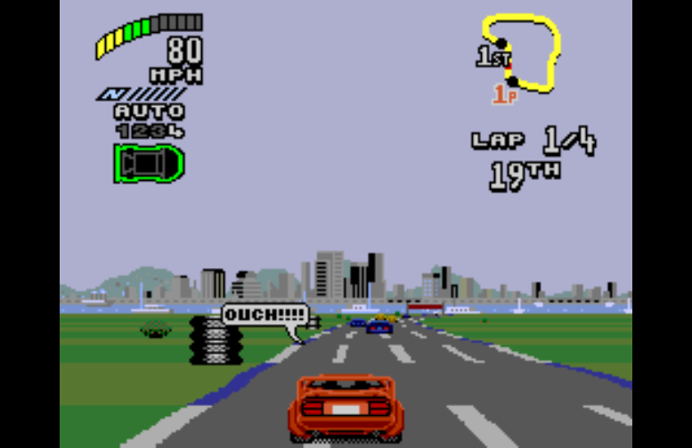
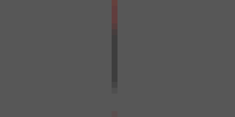
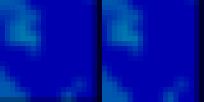

# Linear filtering at the valid picture boundary

Work continues on `vittau/tg2-rain-widescreen` (the existing rain branch).
Engine patch `0025-linear-filter-picture-bounds.patch` owns this change;
`game/tg2_video.c` and generated code are unchanged.

## Cause and fix

The runner allocated its CPU presentation texture at framebuffer capacity
(initially the native stride × maximum height), and only supplied an active
source rectangle to `SDL_RenderCopy`. Custom widescreen allocation also grows
and retains its largest width. After overscan cropping a race is only 200
rows high, while the texture still contains its full allocation and leftover
rows. Width reductions and H32/H40 transitions similarly leave unused columns.
Uploading the full allocation for linear mode refreshed those pixels but did
not make them valid picture pixels.

SDL's Metal renderer uses normalized texture coordinates and a sampler that
clamps at the **texture** boundary, not the source rectangle. The Metal SDK's
`MTLSampler.h` documents ClampToEdge as the default S/T address mode; SDL
`SDL_render_metal.m` only changes the nearest/linear min/mag filters. Hence
a bilinear footprint at the active right/bottom edge can include unused
pixels inside the allocation. The software SDL renderer crops/scales the
source rectangle and did not reproduce the artefact.

The linear CPU path now uploads into a cached streaming texture whose width
and height are exactly the active picture. A dimension change recreates it;
rows are uploaded with the real source pitch. This makes the hardware clamp
boundary coincide with the picture boundary, without padding guesses. The
nearest path retains its original texture and upload. The same helper serves
high-refresh CPU interpolation and the cached image serves the state menu's
background. The existing HD-GPU output and peer-view textures are already
exact-sized and bypass this CPU conversion.

## Default preference

`app_config_defaults()` initializes `linear_filter = 0`. The launcher receives
that value in `RecompLauncherCSettings`; its Genesis profile's `linear_filter=1`
entry is a **capability**, not a default. Launcher settings loading only
updates keys that exist. Game defaults/mod migrations only set game options,
not this filter. Runtime UI reads/writes the same `g_app_config` field; its
bool descriptor's `0,1,1` arguments mean min/max/step, not default On. There
is no separate Graphics reset default in that menu. Release verification
rejects `settings.ini` and `rom.cfg` in payloads, so a payload does not ship a
saved On choice.

The texture creation now explicitly applies the saved preference through
`SDL_SetTextureScaleMode`, instead of accepting an ambient
`SDL_RENDER_SCALE_QUALITY` hint as the actual mode. Missing settings stay Off;
an explicit user's On value stays On. No existing preference is migrated or
rewritten to Off.

## Capture method

Guest screenshots do not show the final filter. The patch adds opt-in
`GENESIS_WINDOW_CAPTURE_FRAMES=1400,1490,...` and
`GENESIS_WINDOW_CAPTURE_PREFIX=/absolute/path/window` diagnostics. They read
SDL's rendered output after the final game copy, before Present, and include
window scaling and bars; ordinary screenshots/hashes are unchanged.

The exact controller route from `game/baseline-route.json` is replayed with
16 capture points: menu and race × Off/16:9/Adaptive/21:9 × integer/fractional
window scale. Windows are 640×448 for menu integer (the H32 menu's 512×448
picture plus bars), 2× the active race picture for race integer, and 777×503
for fractional. Each mode/size is selected 30 guest frames before its capture.
Software uses SDL dummy; Metal uses Cocoa with `LNG_SCRIPT=0 LNG_TEST_HIDDEN=1`
(the existing hidden-window test facility), without showing a desktop window.
Private scripts, captures and logs live in `build/qual/linear/` and
`build/qual/linear-metal/`.

## Results (macOS arm64)

- All eight successful matrix processes (before/after × linear/nearest ×
  software/Metal) exited 0 and left dispatch/floor/interior/unsafe manifests
  at **0/0/0/0**. Each produced all 16 requested window captures.
- **Nearest:** all 16 software pairs and all 16 Metal pairs are byte-identical
  as PNG file bytes, for both menu and race, all four view modes, and both
  window scales. Software linear pairs are also identical (that backend
  already crops its source before filtering).
- **Metal linear:** reproduced edge contamination in all eight race cases
  (Off, 16:9, Adaptive, 21:9 at integer and fractional scales) and in the
  later menu cases after the texture had grown. Earlier menu cases with no
  contaminated allocation are unchanged, apart from at most 1–2 levels of
  GPU texture-coordinate rounding. The representative fractional native
  race has 403 pixel differences above two colour levels, **all on the
  right/bottom picture edge**. The menu example has 406 such differences,
  all on its bottom row. There are 82 common recorded guest-frame hashes
  between the Metal linear runs, all identical: only final sampling changes.
- Fresh-run tests removed `settings.ini`, opened Graphics, and toggled the
  selected filter twice to return to its original value while exercising
  the real settings writer: the new file contains `linear_filter = 0`.
  Repeating with the ambient SDL linear hint still writes 0 and produces
  identical output. Starting with an explicit saved 1 retains 1. Each run
  exited 0 with 0/0/0/0 manifests; captures/settings/check JSON are in
  `build/qual/linear/{fresh,fresh-hint,explicit-on}/`.
- `TG2_RACE_60FPS=0 python3 tools/probe_run.py --exe build/TG2Recomp
  --out build/qual/linear/off --frames 360 --port 4620 --widescreen off
  --shots 300` exited **0**: frame 60 `2A0B972960C5E325`, frame 300
  `1131D937D70234FD`; manifests 0/0/0/0.
- Capture instrumentation build, fixed build, and a clean patch-set
  application/rebuild all exited 0, under the heavy lock with `-j3`.
  Logs: `/tmp/linear-{capture-build,fix-build,patch-build}.log`.

Full presented race (before / after):

Ten-times nearest zooms, **before left / after right**, from the actual
presented captures (no generated pixels or repainting):

Evidence: `build/qual/linear/{probe.log,probe-rest.log,metal-probe.log,
metal-nearest.log,fresh.log,off.log}`, the paired PNG directories, and
`build/qual/linear-metal/linear-comparison.json`. Probe scripts are copied
into `build/qual/linear/{probe,metal-probe,fresh-probe}.py`.

Not separately exercised: Windows/Linux GPU drivers, the generic engine's
HD-GPU and high-refresh interpolation paths, netplay peer view, and a live
owner play session. TG2 hides internal resolution because its game renderer
does not use that generic HD path. Launcher defaults and payload/reset
behaviour were traced in source; the actual fresh-config write was exercised
through recomp-ui in the running game, rather than an interactive launcher
session. No CI or workflow was triggered or modified.

Final clean replay of the committed patch: `tools/apply-engine-patches.sh
--reset` and `flock ~/.cache/tg2-heavy.lock cmake --build build --target
TG2Recomp -j3` exited 0 (`/tmp/linear-final-build.log`); repeating the stock
probe under `build/qual/linear/final-off/` exited 0 with both required hashes
and 0/0/0/0 manifests. Temporary engine/core keep refs preserve the applied
working trees from before the clean validation; no submodule pin changed.
