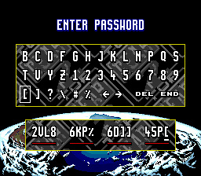
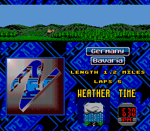
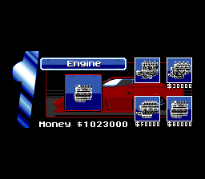
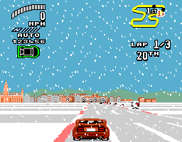

# Top Gear 2 USA passwords

Use **CONTINUE → PASSWORD** (the upper row) to restore a championship,
its money and its car parts. There are **16 countries × 4 races = 64 races**;
a password resumes at the first race of its country. It has no race-slot
field. `stage` is difficulty, not the race number.

**COUNTRY SELECT is a different route.** It asks for proof that the password
has reached at least the selected country. A Germany password (`country=5`)
is rejected if that screen requires Scandinavia (`11`), while a Scandinavia
password is accepted. After acceptance this route selects the requested
country, resets both cars' parts, and supplies country-dependent starting
cash (`country × $10,000`); it does not restore the password's upgrades.
Use the upper PASSWORD row to load the generated max-parts record.

## Screen symbols

The keyboard is a 13-column grid, ordered left to right, top to bottom:

```
row 0: B C D F G H J K L N P Q S        codes 1..13
row 1: T V Y Z 1 2 3 4 5 6 7 8 9        codes 14..26
row 2: [ ] ? \ # %  [control keys] END  codes 27..32; END is column 12
```

`ALPHABET = 'BCDFGHJKLNPQSTVYZ123456789[]?\\#%'`.
Code **15 (`$0F`) is V**, not U. There is no on-screen U. The other symbols
match their existing code positions. A inserts the selected symbol; END
submits. The arrows and DEL are controls, not alphabet entries.

Old tool output misspelled V as U, but its numeric code was still 15: typing
V in that position preserves the intended record. The codec accepts legacy
U as an input alias and always emits V. It strips whitespace, but rejects
other non-screen characters instead of silently dropping a typo.

## What is stored

The normal PASSWORD work area is `$FF2570`. COUNTRY SELECT nests it at
`$FF25EA` (its controller adds `$7A` at `$024018..$02402C`). The validator
uses A0 for either base; all offsets below are relative to that pointer:

| Offset | Contents |
|---|---|
| `$00..$0F` | 16 symbol codes, 1..32 |
| `$10..$19` | 80-bit salted/permuted block |
| `$1A..$23` | 10-byte plaintext record |
| `$24` | signed word: required country (`-1` for PASSWORD; selected country for COUNTRY SELECT) |
| `$26..$54` | decoded words, including checksum at `$26` |

| Field | Plaintext bit offset | Width | Meaning |
|---|---:|---:|---|
| `sum` | 0..6 and 72..79 | **15** | additive checksum: low 7 bits in byte 0 bits 7..1; high 8 bits in byte 9 |
| `flag` | 7 | 1 | 0 single player, 1 two players |
| `country` | 8 | 4 | country index 0..15 |
| `stage` | 12 | 2 | difficulty: 0 Amateur, 1 Professional, 2 Championship |
| `money` | 14 | 10 | player 1 money in $1,000 units, 0..1023 |
| `field30` | 24 | 10 | player 2 money in the same units |
| `u32..u50` | 34..65 | 2 each | 16 part levels: eight per player, interleaved |
| `u52` | 66 | 3 | player 1 paint choice |
| `u54` | 69 | 3 | player 2 paint choice |

**There is no 255-point money/parts tradeoff.** The old codec truncated the
checksum to 8 bits and mistakenly called byte 9 bits 7..1 unused. The ROM
packer at `$02370E..$023714` stores `sum >> 7` as a whole byte; the unpacker
at `$023878..$02387E` shifts that whole byte back by 7. The validator compares
a word. Every legal field combination fits the 15-bit checksum; the largest
representable balance is **1023 ($1,023,000) per player**. An old password
whose checksum was truncated above 255 really is invalid; the updated
`decode()['valid']` checks the full sum, difficulty and country requirement.

## Car parts and paint

The names below are the shop's own labels. Levels are **0 factory**, then
**1 / 2 / 3** for the three purchasable tiers; 3 is the best tier.
Prices are the ROM shop table at `$020338` (units of $1,000), matching the
captured shop pages. The paint IDs are choices, not upgrade levels.

| Shop page | Player 1 field / RAM byte | Player 2 field / RAM byte | Tier 1 / 2 / 3 price |
|---|---|---|---|
| Engine | `u32` / `$FF1B5E` | `u34` / `$FF1FB6` | $30,000 / $50,000 / $80,000 |
| Wet Tires | `u36` / `$FF1B5F` | `u38` / `$FF1FB7` | $1,000 / $2,000 / $3,000 |
| Dry Tires | `u3a` / `$FF1B60` | `u3c` / `$FF1FB8` | $1,000 / $2,000 / $4,000 |
| Gearbox | `u3e` / `$FF1B61` | `u40` / `$FF1FB9` | $10,000 / $30,000 / $50,000 |
| Nitro | `u42` / `$FF1B62` | `u44` / `$FF1FBA` | $5,000 / $15,000 / $30,000 |
| Side Armor | `u4e` / `$FF1B65` | `u50` / `$FF1FBD` | $5,000 / $10,000 / $20,000 |
| Rear Armor | `u4a` / `$FF1B64` | `u4c` / `$FF1FBC` | $5,000 / $10,000 / $20,000 |
| Front Armor | `u46` / `$FF1B63` | `u48` / `$FF1FBB` | $5,000 / $10,000 / $20,000 |
| Paint Shop | `u52` / `$FF1B66` | `u54` / `$FF1FBE` | IDs 0..7; no price |

Paint swatches in code order: red, blue, white/silver, yellow, green, black,
light blue, purple. Stock paint is player 1 red (`u52=0`), player 2 blue
(`u54=1`). Nitro's part level changes boost strength; it is not the charge
counter. A race supplies six charges independently (see RAM_MAP.md).
`money` is loaded into `$FF1B84`; `field30` into `$FF1FDC`.

The loader at `$023B50..$023BDE` proves the interleaving. The shop copies its
ordered words back to those bytes at `$02009A..$020112`; the armor order is
Side/Rear/Front in the shop, versus Front/Rear/Side in the stored bytes.
`$0201C8` holds limits `3,3,3,3,3,3,3,3,7`. Runtime routines independently
confirm the meaning: `$0089BC..$008A78` reads engine, gearbox and the wet/dry
tire selection; `$00E0CE` reads the Nitro level; `$008BC8..$008C4E` applies
the three armor levels to damage. The nine shop captures show these labels
and the loaded $1,023,000 balance.

## Codec and validator

1. Salt key at `$0239B2`: `gnarreKdaehrotoM`. For symbol i,
   `v[i] = (code[i] - 1 - KEY[i]) & 31`.
2. Pack those 16 five-bit values MSB first into 80 bits.
3. Un-permute with the 80-entry table at `$0239C2` (`$0238D2` decoder;
   `$023884` inverse).
4. Unpack the field words with `$02371A`; `$0235C6` is the inverse packer.

`$023594` rejects an empty symbol, a full checksum mismatch, difficulty >2,
or `required_country > decoded_country`. It returns D0=1 at `$0235C0`, or
D0=0 at `$0235C4`. Those two RTS instructions now have read-only game-owned
observers: `tg2_password_trace` returns the latest D0, D7 field sum, A0 work
address and the completed work record before the caller consumes it. Nothing is paused,
patched in guest RAM or stubbed. Raw ROM bytes at both observer sites are
`4E75` and are checked by the tests.

PASSWORD loads decoded country×4 at `$023B54`. COUNTRY SELECT's caller
then overrides it with selected country×4 and resets the cars/cash at
`$004168..$004186`. This explains the route-dependent rejection and why
COUNTRY SELECT must not be used to restore max upgrades. The exact owner's
Germany text is intrinsically valid; V is the correct glyph for its code 15.

## Commands

```sh
python3 tools/tg2_password.py max --country 5
python3 tools/tg2_password.py max --country 5 --stage 2 --two-players --json
python3 tools/tg2_password.py decode '2VL8 6KP% 6D]] 45P['
python3 tools/tg2_password.py decode '2VL8 6KP% 6D]] 45P[' --picker-country 11
python3 tools/tg2_password.py encode --field country=5 --field u54=1
python3 tools/tg2_password_ui.py --out build/qual/passwords/ui --port 4620 \
  --password '2VL8 6KP% 6D]] 45P[' --race
python3 tools/tg2_weather.py
python3 tools/test_tg2_password.py
```

`max` sets both balances to 1023, all sixteen part fields to 3, and preserves
the stock paint choices 0/1. Single player is the default; `--two-players`
changes the flag. Germany's preset is `J4?Z 1]PD #F]\ 4\V?`, with checksum
2100. Single quotes protect literal backslashes in a shell.

`tg2_password_ui.py --picker-country N` (legacy spelling `--country N`)
selects the gated COUNTRY SELECT route; it does not mean the password's
encoded country. The fixed typer confirms COUNTRY SELECT with **START**,
not RIGHT, and asserts the signed word at work base + `$24` equals the
intended requirement before inserting any symbol (`$FF2594` for PASSWORD,
`$FF260E` for COUNTRY SELECT). It verifies every inserted numeric code and writes
`typed-work.bin`, `validated-work.bin` and `validation.json`; the latter
compares the original-ROM result against the codec's contextual validator.
Use `--field country=N` when generating a password, or the upper PASSWORD
route when restoring it. A country already unlocked by the current profile
may not open a password prompt in COUNTRY SELECT.

## Weather races and ready-to-type country passwords

The pointer table is `$01B8E8 + index × 4`. Byte 3 bit 5 of each race
descriptor enables precipitation; bit 6 chooses
its variant **only when bit 5 is on**. `$002B20..$002B40` sets the weather
flags; `$009E0A` selects the animated pattern family: `$0EBBBA` for rain,
`$0EBD3A` for snow. Bavaria rain and Munich snow were captured in game.
The other entries below use the same verified flag/pattern selection.

**Geneva (index 56, descriptor `$01DFF8`, flags `$44`) has no precipitation.**
Its bit 6 alone does not enable snow. Bit 2 selects wet tires independently
of visible precipitation. The earlier Geneva snow labels in the
validation and widescreen docs were wrong.

**These passwords restore the country, starting at slot 1.** Only Bavaria
is immediately rainy at that entry point. For a later weather race, advance
through the championship to the listed slot; there is no password bit that
selects slots 2–4. The debug qualification tools' `--start-slot` is a separate
RAM-based test selector, not a password feature.

| Index | Country / track | Slot | Weather | Flags | Max-parts/max-money password |
|---:|---|---:|---|---|---|
| 3 | Australasia / Sydney | 4 | rain | `0xA5` | `#4#Z 19PD #G]\ 6\V?` |
| 9 | Canada / Niagara | 2 | rain | `0xA4` | `#5[Z 1]PD #G]\ 4\T?` |
| 19 | France / Paris | 4 | rain | `0xA5` | `J4#Z 1]PD #G]\ 4\T?` |
| 20 | Germany / Bavaria | 1 | rain | `0x24` | `J4?Z 1]PD #F]\ 4\V?` |
| 23 | Germany / Munich | 4 | snow | `0x65` | `J4?Z 1]PD #F]\ 4\V?` |
| 34 | Ireland / Killarney | 3 | rain | `0x24` | `#G#Z 1]PD #G]\ 4\V?` |
| 45 | Scandinavia / Helsinki | 2 | snow | `0x64` | `#HBZ 1]PD #F]\ 6\T?` |
| 46 | Scandinavia / Reykjavik | 3 | snow | `0x64` | `#HBZ 1]PD #F]\ 6\T?` |
| 54 | Spain / Madrid | 3 | rain | `0x24` | `JG?Z 1]PD #F]\ 6\V?` |
| 59 | Switzerland / Zurich | 4 | snow | `0x65` | `JH[Z 1]PD #G]\ 6\V?` |
| 62 | U.S.A. / New York | 3 | snow | `0x64` | `JHBZ 1]PD #F]\ 6\V?` |

## Native validation (macOS arm64)






Evidence is local under `build/qual/passwords/`; RAM records and bulk captures
are deliberately not checked in. The `validated-work.bin` files contain the
0x56 bytes copied at the original validator's return, before its caller can
reuse the work area. `validation.json` records D0, D7 and the same bytes as hex.
For newer runs it also records A0 and the parsed words.

| Run directory | Typed password | Original result | Destination / observation |
|---|---|---|---|
| `germany-owner` | `2VL8 6KP% 6D]] 45P[` | D0=1 at `$0235C0`, sum 151 | Running Bavaria, index 20 / `$01C780` |
| `germany-plain` | `YVK2 2HQG CHL2 Y4BT` | D0=1 at `$0235C0`, sum 6 | Running Bavaria, index 20 / `$01C780` |
| `germany-max` | `J4?Z 1]PD #F]\ 4\V?` | D0=1 at `$0235C0`, sum 2100 | Running Bavaria, index 20 / `$01C780`; no RAM writes |
| `germany-max-munich` | `J4?Z 1]PD #F]\ 4\V?` | D0=1 at `$0235C0`, sum 2100 | Initially loads Bavaria index 20; test selector then chooses Munich index 23 / `$01C98A` |
| `germany-gated` | owner's Germany text | D0=0 at `$0235C4`, sum 151 | A0=`$FF25EA`, required country 11, decoded country 5; INVALID PASSWORD |
| `scandinavia-gated` | `P%G8 6KP% 6D]] 65P[` | D0=1 at `$0235C0`, sum 157 | A0=`$FF25EA`, required country 11, decoded country 11; accepted |

The owner's original menu route was not observed. The tests establish that
his Germany text and its V are valid, and that the original country gate can
produce the reported Germany rejection / Scandinavia acceptance. They do not
establish which country requirement was active on his machine.

The Munich capture uses the existing qualification exception: after the real
password loads the country, the test changes `$FF16BE` to 23 and `$FF241C` to
`$01C98A` on the setup screen. It does not modify the precipitation flags,
parts, money or validator. All nine shop pages were captured in
`germany-max-munich/shop-0.png` through `shop-8.png`; `parts.json` records
P1 bytes `030303030303030300`, P2 `030303030303030301`, and both balances
1023. Bavaria rain and Munich snow were visually verified; the other weather
rows are classified from the stock ROM, without new per-track captures.

The owner-text work record is: symbols
`13 0F 09 19 17 08 0B 20 17 03 1C 1C 15 16 0B 1B`, salted block
`580e620bfbaf6692876d`, plaintext `2e5064003fffffff0101`. The normal route
has requirement `$FFFF`; the gated rejection has `$000B`. Its decoded
checksum, country, difficulty and P1 money are 151, 5, 0 and 100 respectively.
The max preset's plaintext is `6853ffffffffffffc110`, with checksum 2100.

Reproduction commands (one process at a time, SDL dummy on macOS):

```sh
flock ~/.cache/tg2-heavy.lock cmake --build build --target TG2Recomp -j3
python3 tools/tg2_password_ui.py --port 4620 --out build/qual/passwords/germany-max \
  --password 'J4?Z 1]PD #F]\ 4\V?' --race
python3 tools/tg2_password_ui.py --port 4620 --out build/qual/passwords/germany-plain \
  --password 'YVK2 2HQG CHL2 Y4BT' --race
python3 tools/tg2_password_ui.py --port 4620 --out build/qual/passwords/germany-gated \
  --password '2VL8 6KP% 6D]] 45P[' --picker-country 11
python3 tools/tg2_password_ui.py --port 4620 --out build/qual/passwords/scandinavia-gated \
  --password 'P%G8 6KP% 6D]] 65P[' --picker-country 11
TG2_RACE_60FPS=0 python3 tools/probe_run.py --exe build/TG2Recomp \
  --out build/qual/passwords/off --frames 360 --port 4620 --widescreen off --shots 300
python3 tools/test_tg2_password.py
```

Configure and the locked `-j3` build exited 0 (`/tmp/password-config.log`,
`/tmp/password-build.log`, `/tmp/password-build-final.log`). All six password runs
in the evidence table plus `off` exited 0; every inspected manifest set is
**0/0/0/0** in dispatch/floor/interior/unsafe order.
`python3 tools/test_tg2_password.py` passed all six tests, including the raw-ROM
observer instructions and exact weather sets; Python compilation and
`git diff --check` exited 0. The stock probe exited 0 and printed:

```
frame 60   2A0B972960C5E325
frame 300  1131D937D70234FD
```

The changes are game-owned passive diagnostics, tools and docs; no engine
patch or generated C is committed. CI was not triggered. Windows/Linux
runtime validation and a replay of the owner's unknown original menu path
were not performed.
