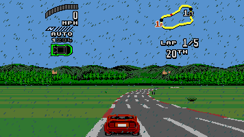
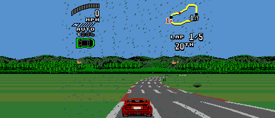
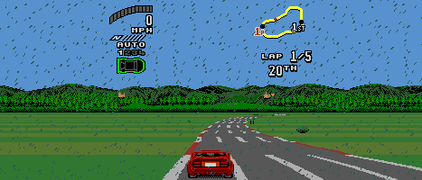

# Weather across the race viewport

The USA ROM installs weather through `$002B20..$002BEC`. Bit 5 of
track descriptor byte 3 enables it; bit 6 selects the variant. The code
unpacks the map from `$0C9996`, adds high priority (`$8000`) plus the
allocated pattern index, and writes it into plane A at `$C800` and `$C840`.
These are the two 256-pixel halves of the 512-pixel name table, starting
at atlas Y=128. Non-weather scene initialization fills the table with
transparent pattern 2 (`$002A52..$002A6A`).

`$0068C8/$006912/$006956` call `$0087FC/$0087EA` when weather is enabled
(RAM `$FF2418`). `$00880C..$00887A` generates its horizontal and vertical
scroll records, with a 256-line vertical wrap. Thus the streaks are plane A
texels animated by the raster program, rather than SAT sprites.

Previously the widescreen renderer continued plane B and captured objects,
while plane A only continued a solid eight-pixel edge run for tunnel walls.
The earlier weather-smear fix correctly prevented isolated particles from
turning into horizontal lines, but did not draw weather in the margins.

`weather_pixel()` now samples the actual plane A weather atlas (Y=128..383)
at the unwrapped output X using that scanline's original H/V scroll and
palette. High-priority weather beats low-priority sprites; high-priority
sprites keep their native ordering. The native centre is copied unchanged.
No guest state, pattern data, simulation, or engine code is modified.
The 60 fps path uses the same discrete source picture for weather and the
native centre, so weather timing also follows the existing synthesis policy.

Validation evidence is recorded below after running the probes.

## Rain replay evidence (macOS arm64)

A stock Germany/Bavaria password was entered through the real menu. The
234 input transitions were replayed with exact-frame input-script captures
at frames 9434 / 9554 / 9674, selecting 16:9 / Adaptive (1600×900) / 21:9.
Before and after processes exited 0; all four runtime manifests had 0 entries.
Private captures and scripts: `build/qual/rain/{before,after}-replay/`.

`build/rain-venv/bin/python tools/check_weather_captures.py
build/qual/rain/before-replay build/qual/rain/after-replay` exited 0:

| Mode | Presented size | Native 256-pixel centre | Changed left/right pixels |
|---|---|---|---|
| 16:9 | 356×200 | identical | 348 / 329 |
| Adaptive | 356×200 | identical | 326 / 348 |
| 21:9 | 467×200 | identical | 696 / 698 |

Only particle texels change in the margins; both sides have the same sparse
coverage. Sampling the same 512-pixel map across the old boundary preserves
particle shape, density, phase, and the original raster motion.

| | Before | After |
|---|---|---|
| 16:9 |  |  |
| 21:9 |  |  |

`TG2_RACE_60FPS=0 python3 tools/probe_run.py --exe build/TG2Recomp
--out build/qual/rain/off --frames 360 --port 4620 --widescreen off --shots 300`
exited 0: frame 60 `2A0B972960C5E325`, frame 300 `1131D937D70234FD`.
